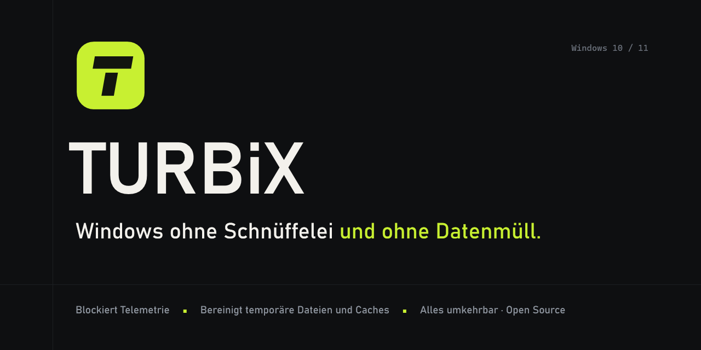
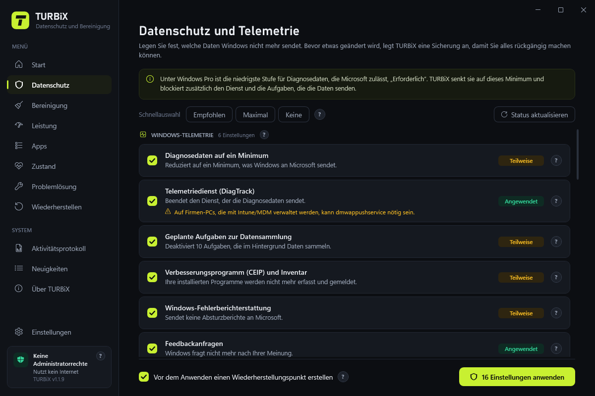
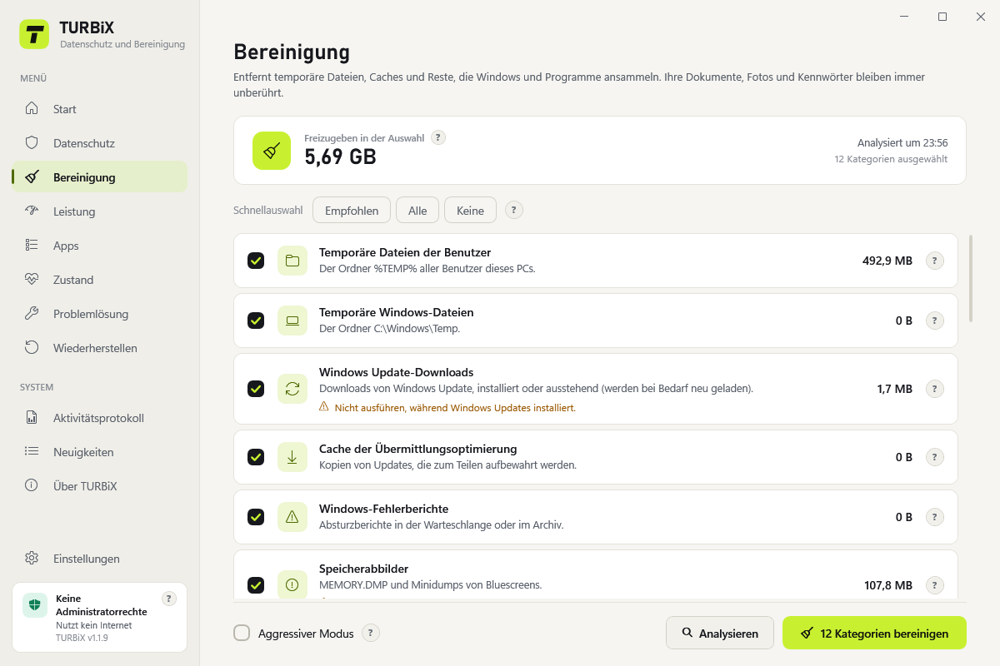
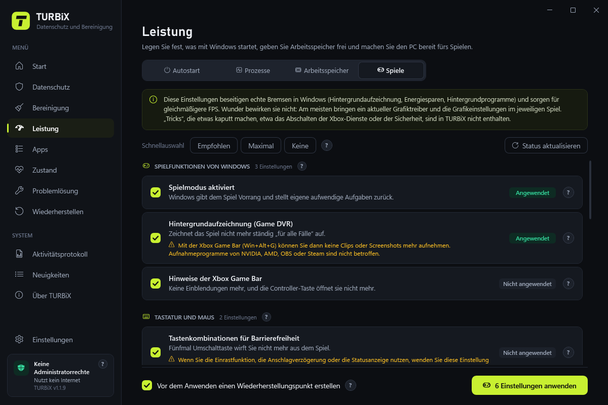
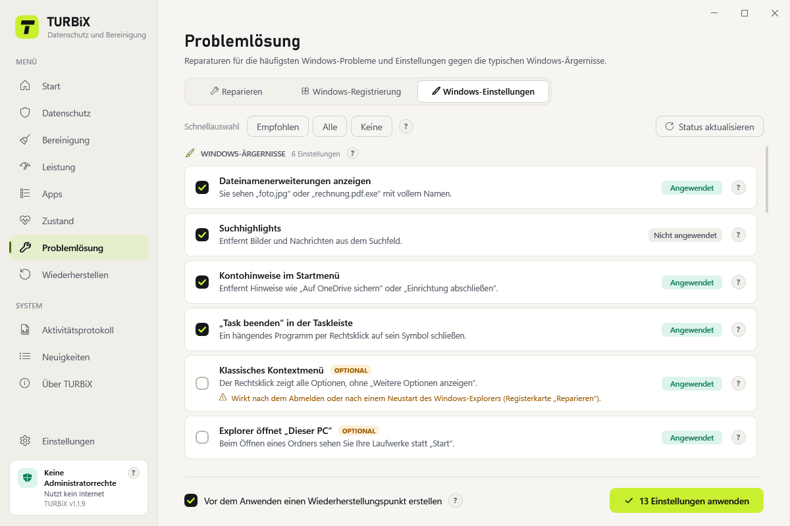

<p align="center">
  
</p>

<p align="center">
  <a href="README.md">English</a> ·
  <a href="README.es.md">Español</a> ·
  <a href="README.pt-BR.md">Português (Brasil)</a> ·
  <a href="README.fr.md">Français</a> ·
  <b>Deutsch</b> ·
  <a href="README.ru.md">Русский</a>
</p>

<p align="center"><sub>Frei und Open Source · <a href="#mitmachen">Mitmachen</a> · <a href="#spenden">Spenden</a></sub></p>

# TURBiX

<p align="center">
  <a href="https://github.com/JulianR87/TURBiX/releases/latest"></a>
  <a href="https://github.com/JulianR87/TURBiX/releases"></a>
  <a href="LICENSE"></a>
  
</p>

<p align="center"><b><a href="https://github.com/JulianR87/TURBiX/releases/latest">Neueste Version herunterladen</a></b></p>

TURBiX ist ein kostenloses Open-Source-Programm für **Windows 10 und Windows 11**, das vier Dinge erledigt:

- **Schaltet die Telemetrie ab**, also die Datensammlung von Windows und den verbreitetsten Programmen.
- **Verbessert die Leistung**: Sie legen fest, was mit Windows startet, geben Arbeitsspeicher frei und machen den PC bereit fürs Spielen.
- **Findet und behebt Probleme**: TURBiX erkennt, warum der PC langsam ist, und führt die üblichen Windows-Reparaturen aus.
- **Entfernt temporäre Dateien, Caches und Reste**, die unnötig Platz belegen.

TURBiX ist eine einzige `TURBiX.exe`. Sie läuft ohne Installation (wer möchte, nimmt das Installationsprogramm), und es muss nichts weiter heruntergeladen werden: TURBiX verwendet .NET Framework 4.6.2, das in Windows 10 (ab 1607) und Windows 11 bereits enthalten ist. Es läuft auf 32- und 64-Bit-Systemen und nutzt kein Internet.

<p align="center">
  
  
</p>
<p align="center">
  
  
</p>

## Inhalt

- [Auf einen Blick](#auf-einen-blick)
- [Was TURBiX macht](#was-turbix-macht)
- [Einstellungen, Symbol neben der Uhr und Hintergrund](#einstellungen-symbol-neben-der-uhr-und-hintergrund)
- [Wiederherstellen, Aktivitätsprotokoll und Neuigkeiten](#wiederherstellen-aktivitätsprotokoll-und-neuigkeiten)
- [Sicherheit](#sicherheit)
- [Voraussetzungen](#voraussetzungen)
- [Download und Verwendung](#download-und-verwendung)
- [Sprachen](#sprachen)
- [Wo TURBiX seine Daten speichert](#wo-turbix-seine-daten-speichert)
- [Befehlszeilenoptionen](#befehlszeilenoptionen)
- [Häufige Fragen](#häufige-fragen)
- [Bekannte Einschränkungen](#bekannte-einschränkungen)
- [Kompilieren](#kompilieren)
- [Marke](#marke)
- [Mitmachen](#mitmachen)
- [Lizenz](#lizenz)

## Auf einen Blick

- **Alles lässt sich rückgängig machen.** Bevor TURBiX etwas ändert, speichert es den vorherigen Zustand. Im Bereich **Wiederherstellen** setzen Sie jede Sitzung mit Änderungen auf diesen Zustand zurück.
- **Jede Option wird erklärt.** Neben jeder steht eine Schaltfläche **?**, die in wenigen Zeilen sagt, was die Option tut und wie sie sich auswirkt.
- **Erst prüfen, dann ändern.** Bereinigung, Diagnose, Zustand und Registrierung werden zuerst nur untersucht, ohne etwas zu ändern, was angewendet wird, entscheiden Sie.
- **Ehrlich.** TURBiX verspricht keine Wunder: Liegt es an einer alten Festplatte oder an zu wenig Arbeitsspeicher, sagt es das. „Tricks“, die etwas kaputt machen, sind nicht dabei.
- **Nutzt kein Internet.** TURBiX lädt nichts herunter, sendet keine Daten und kennt weder Konten noch Werbung.
- **Die Sicherheit bleibt unberührt.** Windows Update, Microsoft Defender, SmartScreen und die Firewall bleiben, wie sie sind.
- **Auf sauberen virtuellen Maschinen getestet.** Jede Version wird auf einem frisch installierten Windows 10 und 11 ausprobiert, mit absichtlich wenig Hardware (Windows 10 mit 2 Kernen und 2 GB RAM, Windows 11 mit 2 Kernen und 4 GB, dem Minimum), damit es einem bescheidenen PC ähnelt. Mit der vollständigen Optimierung sank unter Windows 10 der Speicherverbrauch im Leerlauf um 31 % (von 1000 auf 694 MB), die Prozesse um 28 % (von 88 auf 63) und die Dienste um 18 % (von 97 auf 80), bei 1,1 GB freigegebenem Speicherplatz. Unter Windows 11 sank der Speicher um 22 % (von 2019 auf 1580 MB), die Prozesse um 14 % (von 129 auf 112) und die Dienste um 7 % (von 88 auf 82), bei 3,1 GB freigegeben. Der Start änderte sich in beiden Fällen kaum. Die Werte sind ungefähr und stammen aus einer virtuellen Umgebung, je nach Hardware können sie besser oder schlechter ausfallen. Auf einem physischen PC fallen sie meist besser aus, das haben wir aber nicht gemessen.
- **Sechs Sprachen**, heller und dunkler Modus und ein Symbol neben der Uhr mit Schnellzugriffen.

## Was TURBiX macht

### Datenschutz und Telemetrie

| Gruppe | Was dazugehört |
|---|---|
| Windows-Telemetrie | Umfang der Diagnosedaten, die Dienste DiagTrack und dmwappushservice, 10 geplante Aufgaben zur Datensammlung, CEIP und Inventar, Fehlerberichterstattung, Feedbackanfragen |
| Datenschutz | Werbe-ID, Aktivitätsverlauf, maßgeschneiderte Erfahrungen, Freihand- und Tastatureingaben, Sprachliste für Websites, Diagnosedaten anderer Apps\*, Nachverfolgung geöffneter Apps\*, Online-Spracherkennung\*, Standort\* |
| Werbung und Vorschläge | Websuche im Startmenü, vorgeschlagene Apps, Tipps und Werbung im Startmenü, auf dem Sperrbildschirm und im Explorer |
| Künstliche Intelligenz | Copilot und Recall\* |
| Apps | Telemetrie von Office, von NVIDIA (falls installiert), von Entwicklerwerkzeugen (.NET, PowerShell, VS Code…), von Microsoft Edge\* sowie die Übermittlungsoptimierung mit PCs im Internet\* |

\* **Erweiterte** Einstellungen: Sie werden nur mit dem Profil „Maximal“ ausgewählt, weil sie eine Funktion abschalten können. Ihr Hinweis erscheint in Gelb.

### Bereinigung

Temporäre Dateien der Benutzer und von Windows · Windows Update-Downloads · Cache der Übermittlungsoptimierung · Fehlerberichte · Speicherabbilder · Protokolldateien des Systems · Internetcache · Browsercache (Chrome, Edge, Brave, Vivaldi, Opera, Firefox) · Cache von Apps (Discord, Teams, Spotify, Steam, Slack, VS Code) · Microsoft Store-Cache · DNS-Cache.

Optional: Shadercache · Miniaturansichten · Treiberinstallationen · Papierkorb · zuletzt verwendete Elemente · Prefetch · Ereignisprotokolle · WinSxS-Bereinigung mit DISM · vorherige Windows-Installation (Windows.old und Reste von Updates, über die Datenträgerbereinigung von Windows).

Zuerst wird **analysiert** (nur lesend) und angezeigt, wie viel jede Kategorie belegt, danach entscheiden Sie, was bereinigt wird.

### Leistung

- **Autostart.** Listet die Programme auf, die sich bei der Anmeldung von selbst öffnen (Registrierung, Autostart-Ordner und Apps aus dem Microsoft Store), und schaltet sie per Schalter ein oder aus. Dahinter steckt derselbe Mechanismus wie im Task-Manager: Deinstalliert wird nichts.
- **Prozesse.** Alle laufenden Prozesse wie im Task-Manager, mit Prozessor, Arbeitsspeicher und Threads. Die Prozesse, die ein Programm startet, lassen sich darunter aufklappen, jeder „Diensthost“ zeigt, welchen Dienst er ausführt, und ein Task lässt sich beenden (Prozesse, die Windows braucht, sind gesperrt).
- **Arbeitsspeicher.** Auslastung in Echtzeit, die Programme mit dem größten Verbrauch, eine Schaltfläche zum Freigeben von Speicher (verkleinert die Arbeitssätze und leert die Standbyliste) und eine automatische Freigabe alle 5, 10, 15, 30 oder 60 Minuten, solange TURBiX geöffnet ist, auch wenn es nur neben der Uhr läuft. Eine Windows-Benachrichtigung meldet, wie viel Speicher freigegeben wurde. Speicher freizugeben hilft, wenn er fast voll ist, einen PC, der genug davon hat, macht es nicht schneller.
- **Spiele.** 13 Einstellungen: Spielmodus, Hintergrundaufzeichnung (Game DVR), Hinweise der Game Bar, Tastenkombinationen für Barrierefreiheit, Mausbeschleunigung\*, Multimedia-Priorität, hardwarebeschleunigte GPU-Planung\*, Energiesparplan „Höchstleistung“\*, Energiedrosselung\*, Edge im Hintergrund, Store-Apps im Hintergrund\*, Widgets\* und visuelle Effekte\*.

Bewusst nicht dabei sind „Tricks“, die etwas kaputt machen oder nichts bewirken: die Xbox-Dienste, SysMain oder die Auslagerungsdatei abschalten, Änderungen mit `bcdedit` und alles, was die Sicherheit schwächt.

### Netzwerk

- **Datenverkehr.** Welche Programme das Netzwerk nutzen und wie viel sie herunter- und hochladen, live und insgesamt, nach Programm gruppiert. Jeder „Diensthost“ nennt den Windows-Dienst dahinter. Gezählt wird nur echter Netzwerkverkehr (Verkehr, der den PC nicht verlässt, wird ignoriert) und es sind Administratorrechte nötig.
- **Verbindungen.** Jede TCP-Verbindung mit Programm, Remoteadresse und -port, dem Dienst (HTTPS, DNS …), dem Ziel (Internet, lokales Netzwerk oder dieser PC) und dem Zustand. Eine Verbindung lässt sich mit einem Klick schließen (nur IPv4). Das Programm kann eine neue öffnen.
- **Offene Ports.** Wer lauscht, und ob der Port nur von diesem PC aus oder aus dem Netzwerk erreichbar ist. Heikle Ports (Dateifreigabe, Remotedesktop, Datenbanken …) sind zur Prüfung markiert.
- **Sperren.** Sperrt ein Programm, eine IP-Adresse oder einen Port mit Regeln der Windows-Firewall, gruppiert unter „TURBiX“. Sie erscheinen im Tab Sperren und werden mit „Entsperren“ entfernt. TURBiX sperrt weder Windows-Komponenten noch sich selbst, Ihren Router oder Ihre DNS-Server, weil das Ihre eigene Verbindung kappen würde. Die Regeln bleiben in der Firewall, auch wenn Sie TURBiX deinstallieren, entsperren Sie also vorher. Es nutzt kein Internet: Hostnamen werden nicht aufgelöst.

### Apps

- **Windows-Apps.** Entfernt vorinstallierte Apps aus einer bekannten Liste (Spiele und Werbe-Apps, Solitaire, Clipchamp, Nachrichten, Cortana, Skype…) über die Paketverwaltung von Windows, ohne PowerShell. Der Microsoft Store, Xbox, der Rechner, „Hilfe anfordern“ und Systemkomponenten werden nie angeboten. Das lässt sich nicht über „Wiederherstellen“ rückgängig machen: Die Apps werden aus dem Microsoft Store neu installiert.
- **Installierte Programme.** Die Liste aus Einstellungen › Apps, mit Größe und Suchfeld. „Deinstallieren“ öffnet das offizielle Deinstallationsprogramm des jeweiligen Programms.

### Zustand

Der Zustand jeder Komponente, so wie sie ihn an Windows meldet: Laufwerke (S.M.A.R.T.: Zustand, Verschleiß, Temperatur, Betriebsstunden, Fehler), Akku (Kapazität im Vergleich zum Neuzustand und Ladezyklen), Arbeitsspeicher, Prozessor (WHEA-Hardwarefehler, Temperatur, falls der PC sie ausgibt), Grafikkarte und Alter ihres Treibers, Geräte mit Treiberproblemen sowie Bluescreens, unerwartete Abschaltungen und Datenträgerfehler der letzten 30 Tage. Nur lesend.


### Problemlösung

- **Diagnose** (auf der Startseite). Prüft die häufigsten Ursachen für einen langsamen PC: Festplatte (HDD) oder Laufwerk mit Fehlern, wenig Speicherplatz, wenig Arbeitsspeicher, zu viele Programme im Autostart, Tage ohne Neustart, ausstehender Neustart und Energiesparplan. Es wird nur gelesen, zu jedem Punkt steht, was zu tun ist.
- **Reparieren.** Die Standardreparaturen von Windows per Schaltfläche: SFC, DISM RestoreHealth, Datenträgerprüfung (`chkdsk /scan`), Netzwerk zurücksetzen, Druckwarteschlange freimachen und Explorer neu starten.
- **Windows-Registrierung.** Sucht Einträge, die auf nicht mehr vorhandene Dateien zeigen (defekte Autostart-Einträge, Phantomprogramme in der Deinstallationsliste, Pfade und Bibliotheken gelöschter Programme, Namenscache), und entfernt sie, vorher wird eine Sicherung angelegt, die sich wiederherstellen lässt. Markiert wird nur, was sich nachprüfen lässt, COM-Klassen und Dateizuordnungen bleiben unberührt.
- **Windows-Einstellungen.** Dateinamenerweiterungen anzeigen, Suchhighlights, Kontohinweise im Startmenü, „Task beenden“ in der Taskleiste, klassisches Kontextmenü\*, Explorer öffnet „Dieser PC“\*, Speicheroptimierung, Schnellstart\*, Ruhezustand\* und SysMain auf Festplatten\* (wird nur angeboten, wenn Windows auf einer HDD liegt). Taskleiste und Start: Edge-Verknüpfung nach Updates, die Schaltflächen „Jetzt besprechen“, „Chat“ und Cortana, Taskansicht\*, Suche als Symbol\*, Taskleiste linksbündig\*, zuletzt verwendete Dateien\* und ausgeblendete Dateien\*. Optionale Dienste: Fax, Demomodus für den Einzelhandel, Offlinekarten, Windows Media Player-Netzwerkfreigabe, Windows-Insider-Programm\*, Programmkompatibilitäts-Assistent\*, Druckwarteschlange\* und Suchindizierung\*.


## Einstellungen, Symbol neben der Uhr und Hintergrund

Auf der Seite **Einstellungen** steht alles, was sich an TURBiX selbst einstellen lässt:

- **Darstellung und Sprache.** Helles oder dunkles Design oder dasselbe wie Windows. Die Sprache richtet sich nach Windows, lässt sich aber von Hand ändern.
- **TURBiX beim Windows-Start öffnen.** TURBiX bleibt neben der Uhr, ohne das Fenster zu öffnen, damit die automatische Freigabe von Arbeitsspeicher immer aktiv ist. Weil TURBiX Administratorrechte braucht, legt es dafür in der Aufgabenplanung eine Aufgabe namens „TURBiX“ an, sie wird gelöscht, wenn Sie die Option ausschalten.
- **Symbol neben der Uhr.** Ein Doppelklick öffnet das Fenster. Per Rechtsklick: TURBiX öffnen, Arbeitsspeicher freigeben, temporäre Dateien bereinigen, Einstellungen öffnen oder beenden. Die Aktionen aus dem Menü melden ihr Ergebnis mit einer Windows-Benachrichtigung.
- **Beim Schließen des Fensters weiterlaufen.** Das X blendet das Fenster aus, und TURBiX bleibt neben der Uhr. Zum vollständigen Schließen dient „TURBiX beenden“, davor wird nachgefragt (das lässt sich abschalten).
- **Automatische Freigabe von Arbeitsspeicher.** Wie oft, ob nur bei einer Auslastung über 80 % und ob jedes Mal eine Benachrichtigung erscheint.
- **Daten.** Den Datenordner öffnen und alle Optionen auf den Auslieferungszustand zurücksetzen.

Wenn TURBiX bereits läuft und noch einmal gestartet wird, erscheint das vorhandene Fenster statt einer zweiten Kopie. Bei ausgeblendetem Fenster nutzt TURBiX den Prozessor kaum: Es prüft nur alle 30 Sekunden den Arbeitsspeicher.

## Wiederherstellen, Aktivitätsprotokoll und Neuigkeiten

- **Wiederherstellen.** Jedes Mal, wenn Sie Einstellungen anwenden oder die Registrierung reparieren, entsteht eine Sitzung mit einer Sicherung des vorherigen Zustands. Hier machen Sie die ganze Sitzung mit einem Klick rückgängig. Von hier aus lässt sich auch die „Systemwiederherstellung“ von Windows öffnen.
- **Aktivitätsprotokoll.** Alles, was TURBiX tut, wird mit Uhrzeit und Ergebnis festgehalten, in einer Datei pro Tag. Sie können es kopieren oder den Ordner öffnen.
- **Neuigkeiten.** Die Änderungen jeder Version, direkt im Programm und in der Sprache der Oberfläche. Der Inhalt ist derselbe wie in [`src/Turbix/Changelog/de.md`](src/Turbix/Changelog/de.md).

## Sicherheit

- Windows Update, Microsoft Defender, SmartScreen und die Firewall werden **nie** deaktiviert, und die Datei `hosts` wird nicht verändert.
- Bevor ein Wert geändert wird, landet das Original in `C:\ProgramData\TURBiX\Backups`. Im Bereich **Wiederherstellen** machen Sie jede Sitzung mit einem Klick rückgängig.
- Auf Wunsch erstellt TURBiX vor dem Anwenden einen **Wiederherstellungspunkt** von Windows.
- Browser: Gelöscht wird nur der Cache. Cookies, Kennwörter, Verlauf und geöffnete Sitzungen bleiben unberührt.
- Ist ein Programm geöffnet, wird sein Cache übersprungen. Temporäre Dateien, die jünger als 24 Stunden sind, bleiben erhalten, außer Sie schalten den aggressiven Modus ein.
- Die Bereinigung folgt nie symbolischen Verknüpfungen oder Verzeichnisverbindungen.
- Alles wird in `C:\ProgramData\TURBiX\Logs` protokolliert.
- TURBiX verbindet sich nicht mit dem Internet und sendet keinerlei Daten.

## Voraussetzungen

- Windows 10 ab Version 1607 oder Windows 11. 32 oder 64 Bit.
- .NET Framework 4.6.2 oder neuer, das in diesen Windows-Versionen bereits enthalten ist. Es muss nichts installiert werden.
- Ein Konto mit Administratorrechten.
- Eine Internetverbindung ist nicht nötig. Einzige Ausnahme, auf die das Programm hinweist: Bei der Reparatur `DISM /RestoreHealth` kann *Windows* Dateien von Windows Update herunterladen.

## Download und Verwendung

Es gibt zwei Varianten, beide im Bereich [Releases](../../releases):

- **Installationsprogramm (`TURBiX-Setup.exe`).** Kopiert TURBiX nach `Programme`, legt die Verknüpfung im Startmenü an (und auf dem Desktop, wenn Sie möchten) und trägt es in die App-Liste von Windows ein, wo es sich wie jedes andere Programm deinstallieren lässt.
- **Portabel (`TURBiX.exe`).** Eine einzige Datei, die aus jedem Ordner läuft, ohne etwas zu installieren.

In beiden Fällen fragt Windows nach Administratorrechten, weil sie nötig sind, um Systemeinstellungen zu ändern. Beginnen Sie danach mit der **Schnelloptimierung** oder gehen Sie die einzelnen Bereiche durch.

Die Deinstallation von TURBiX macht die Änderungen an Windows nicht rückgängig: Wenn Sie das möchten, verwenden Sie vorher den Bereich **Wiederherstellen**. Die Sicherungen bleiben in `C:\ProgramData\TURBiX`.

> **SmartScreen-Warnung.** Solange die Programmdatei keine digitale Signatur hat, kann Windows „Der Computer wurde durch Windows geschützt“ anzeigen. Klicken Sie auf *Weitere Informationen → Trotzdem ausführen*. Wenn Ihnen das lieber ist, kompilieren Sie TURBiX selbst aus dem Quellcode.

> **Virenschutz.** Manche Virenschutzprogramme stufen TURBiX fälschlich mit einer generischen Erkennung ein: Es ist ein neues Programm ohne Signatur, das Administratorrechte verlangt und Windows-Einstellungen ändert. TURBiX verbindet sich nicht mit dem Internet, und der gesamte Code liegt in diesem Repository. Falls Ihnen das passiert, können Sie die Datei bei VirusTotal prüfen, TURBiX selbst kompilieren oder unter [Issues](../../issues) Bescheid geben, damit wir es dem Hersteller melden.

> **Mehrere Benutzer.** Einstellungen pro Benutzer (zum Beispiel die Werbe-ID) gelten für das Konto, mit dem TURBiX ausgeführt wird. Auf einem PC mit mehreren Konten führen Sie es in jedem davon aus.

## Sprachen

TURBiX erscheint von selbst in der Sprache von Windows: **Spanisch, Englisch, Portugiesisch (Brasilien), Französisch, Deutsch und Russisch**. Bei jeder anderen Sprache erscheint es auf Englisch. Unter **Einstellungen** können Sie eine andere wählen, die Änderung wirkt beim nächsten Start von TURBiX.

Die Texte liegen in einfachen Textdateien (`src/Turbix/Strings/<Bereich>.<Sprache>.txt`), eine pro Sprache. Die Anleitung zum Korrigieren oder Hinzufügen einer Übersetzung steht in [`tools/TRANSLATING.de.md`](tools/TRANSLATING.de.md).

## Wo TURBiX seine Daten speichert

| Was | Wo |
| --- | --- |
| Sicherungen jeder Änderung | `C:\ProgramData\TURBiX\Backups` |
| Aktivitätsprotokoll (eine Datei pro Tag) | `C:\ProgramData\TURBiX\Logs` |
| Einstellungen (Design, Sprache, Optionen der Seite „Einstellungen“) | Registrierung: `HKEY_CURRENT_USER\Software\TURBiX` |
| Start mit Windows | Aufgabe „TURBiX“ in der Aufgabenplanung |
| Installiertes Programm (nur mit dem Installationsprogramm) | `C:\Program Files\TURBiX` |

Den Ordner in `ProgramData` können nur Administratoren ändern. Mehr speichert TURBiX nicht, und außerhalb dieser Orte schreibt es nichts, abgesehen von den Änderungen, die Sie selbst anwenden.

## Befehlszeilenoptionen

| Option | Was sie bewirkt |
| --- | --- |
| `--lang es\|en\|pt\|fr\|de\|ru` | Öffnet TURBiX in dieser Sprache, ohne die gespeicherte Einstellung zu ändern. |
| `--startup` | Startet neben der Uhr, ohne das Fenster anzuzeigen. Das verwendet die Autostart-Aufgabe. |
| `--uninstall` | Deinstalliert die installierte Kopie. Das ruft Windows unter Einstellungen › Apps auf. |
| `TURBiX-Setup.exe --silent` | Installiert, ohne ein Fenster anzuzeigen (für Paketmanager und unbeaufsichtigte Installationen). Mit `--no-desktop` wird keine Desktopverknüpfung angelegt. |
| `--uninstall --silent` | Deinstalliert ohne Rückfrage. |

## Häufige Fragen

**Macht TURBiX meinen PC rasend schnell?**
Das hängt davon ab, was ihn bremst. Programme aus dem Autostart zu nehmen, Speicherplatz freizugeben und nicht genutzte Dienste abzuschalten merkt man. Liegt es an einer Festplatte (HDD) oder an zu wenig Arbeitsspeicher, sagt TURBiX Ihnen das, aber beheben lässt es sich nur durch den Tausch des Bauteils.

**Kann ich rückgängig machen, was ich getan habe?**
Ja, unter **Wiederherstellen**, immer die ganze Sitzung. Zwei Dinge lassen sich dort nicht zurückholen: die bei der Bereinigung gelöschten Dateien und entfernte Windows-Apps, die aus dem Microsoft Store neu installiert werden. Die Oberfläche weist vor dem Bestätigen darauf hin.

**Ist es sicher, die Registrierung zu bereinigen?**
TURBiX entfernt nur Einträge, die auf Dateien zeigen, deren Fehlen es geprüft hat, und legt vorher eine Sicherung an. Es „optimiert“ und komprimiert die Registrierung nicht und sagt das auch deutlich: Die Registrierung zu bereinigen macht den PC nicht schneller.

**Warum verlangt TURBiX Administratorrechte?**
Weil fast alles, was es tut (Dienste, geplante Aufgaben, Systemeinstellungen, Bereinigung von Windows-Ordnern), sie erfordert.

**Muss TURBiX geöffnet bleiben?**
Nein. Die Einstellungen bleiben angewendet, auch wenn Sie TURBiX schließen. Neben der Uhr weiterlaufen muss es nur, wenn Sie die automatische Freigabe von Arbeitsspeicher möchten.

**Sendet TURBiX irgendwelche Daten?**
Keine. TURBiX enthält keinen Netzwerkcode: keine Statistiken, keine automatischen Updates, keine Konten.

**Wie aktualisiere ich TURBiX?**
Laden Sie die neue Version herunter. Mit dem Installationsprogramm installieren Sie einfach darüber: Einstellungen und Sicherungen bleiben erhalten. Bei der portablen Variante ersetzen Sie die Datei.

## Bekannte Einschränkungen

- Eine lange Aufgabe lässt sich nicht mittendrin abbrechen, solange sie läuft, lässt sich TURBiX nicht schließen.
- Rückgängig gemacht wird die ganze Sitzung, nicht eine einzelne Einstellung.
- Wird TURBiX mit einem anderen Administratorkonto als Ihrem geöffnet, gelten die Einstellungen pro Benutzer für dieses Konto. Die Diagnose weist darauf hin.
- „Autostart“ listet keine geplanten Aufgaben auf, die bei der Anmeldung ausgeführt werden.
- Alte Aktivitätsprotokolle und Sicherungen werden nicht von selbst gelöscht.

## Kompilieren

Sie brauchen das [.NET SDK](https://dotnet.microsoft.com/download) (6 oder neuer). Die Referenzassemblys für .NET Framework werden automatisch heruntergeladen.

```cmd
build.cmd
```

In `dist` liegen danach zwei Dateien: `TURBiX.exe` (portabel) und `TURBiX-Setup.exe` (Installationsprogramm, das dieselbe `TURBiX.exe` enthält). Um nur das Programm zu kompilieren, geht auch `dotnet build src\Turbix -c Release`.

Das Programm ist C# mit WPF auf .NET Framework 4.6.2, ohne externe Pakete und ohne PowerShell: eine einzige exe ohne Abhängigkeiten.

### Aufbau

```
src/Turbix/
  Core/          Registrierung, Dienste, Aufgaben, Sicherungen, Arbeitsspeicher, Prozesse, Zustand, Installationsprogramm
  Tweaks/        Kataloge der Einstellungen (Datenschutz, Spiele und Windows) und die Engine, die sie anwendet und zurücknimmt
  Cleanup/       Katalog der Bereinigung und Engine für Analyse und Löschen
  ViewModels/    Logik der Oberfläche (MVVM)
  Views/         WPF-Seiten, Dialoge, Symbol neben der Uhr und Fenster des Installationsprogramms
  Controls/      Hilfeschaltfläche „?“, Fortschrittsring und Konverter
  Themes/        Helle und dunkle Farbpalette, Schriften, Stile und Designwechsel
  Localization/  Laden der Texte und Pluralformen je Sprache
  Strings/       Texte der Oberfläche, eine Datei pro Bereich und Sprache
  Changelog/     „Neuigkeiten“ in den Übersetzungen (Spanisch ist CHANGELOG.md)
tools/           Prüfskript für die Texte und Übersetzungsanleitung
assets/brand/    Logo und Banner
```

Um eine Einstellung hinzuzufügen, bearbeiten Sie `Tweaks/TweakCatalog.cs` (Datenschutz), `GamingCatalog.cs` oder `WindowsCatalog.cs`. Jede Einstellung ist eine Liste von Aktionen für Registrierung, Dienste oder Aufgaben, um Sicherung und Rücknahme kümmert sich die Engine. Um eine Bereinigungskategorie hinzuzufügen, bearbeiten Sie `Cleanup/CleanupCatalog.cs`. Jeder sichtbare Text gehört nach `Strings`, in allen sechs Sprachen, `python tools/check_strings.py` prüft, dass keiner fehlt.

## Marke

Das Logo ist ein schräg gestelltes „T“ im Schablonenstil auf einer limettengrünen Kachel (`#C8F031`) mit fast schwarzer Tinte (`#12140F`). Die Schrift der Überschriften ist Bahnschrift, die in Windows enthalten ist. Die Dateien liegen in [`assets/brand`](assets/brand).

## Mitmachen

TURBiX ist ein öffentliches, kostenloses Projekt ohne Werbung. Es sammelt keine Daten und hat keine Bezahlversion: Es lebt von Freizeit und von der Hilfe der Menschen, die es nutzen. Jeder Beitrag zählt, und programmieren muss man dafür nicht können:

- **Melden Sie einen Fehler oder schlagen Sie eine Verbesserung vor**, unter [Issues](../../issues). Je mehr Details (Windows-Version, was Sie getan haben, was Sie erwartet haben), desto leichter lässt es sich beheben.
- **Verbessern Sie eine Übersetzung.** Die Texte liegen in `src/Turbix/Strings`, die Anleitung in [`tools/TRANSLATING.de.md`](tools/TRANSLATING.de.md).
- **Schicken Sie Code** per *Pull Request*: eine neue Einstellung, eine Bereinigungskategorie oder eine Fehlerbehebung.
- **Erzählen Sie jemandem davon**, dem TURBiX nützen könnte. So wächst das Projekt am besten.

### Spenden

Wenn TURBiX Ihnen Zeit gespart oder einen lahmen PC wieder flott gemacht hat, können Sie die Entwicklung mit einer Spende unterstützen. Sie ist völlig freiwillig: Das Programm ist und bleibt kostenlos, mit oder ohne Spende.

| Währung | Netzwerk | Adresse |
| --- | --- | --- |
| **Bitcoin (BTC)** | Bitcoin | `bc1q527vjd3vcj6vwg6dg8g0dengh6hd9944l73jqe` |
| **Ethereum (ETH)** | BEP20 (BNB Smart Chain) | `0xC1162610b1A6b8532f4233Db598F624D8EF4d2C4` |
| **Tether (USDT)** | BEP20 (BNB Smart Chain) | `0xC1162610b1A6b8532f4233Db598F624D8EF4d2C4` |

> **Wichtig: Prüfen Sie vor dem Senden das Netzwerk.** BTC nur über das Bitcoin-Netzwerk, ETH und USDT nur über das BEP20-Netzwerk. Eine Überweisung über ein anderes Netzwerk geht verloren und lässt sich nicht zurückholen.

Danke, dass Sie helfen, TURBiX frei zu halten.

## Lizenz

[MIT](LICENSE). Microsoft, Windows, Edge, Office und Copilot sind Marken der Microsoft Corporation. TURBiX steht in keiner Verbindung zu Microsoft.
