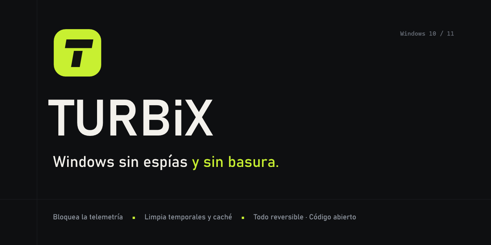
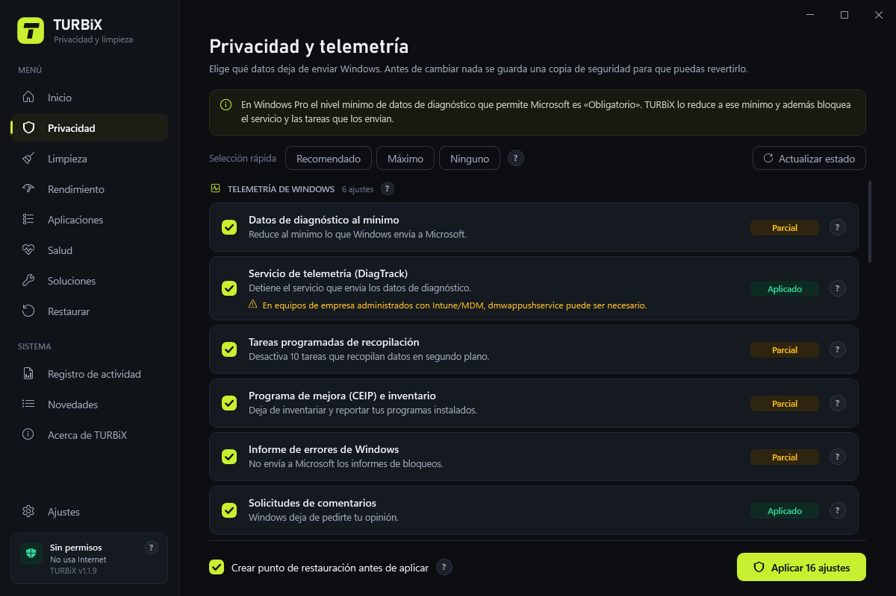
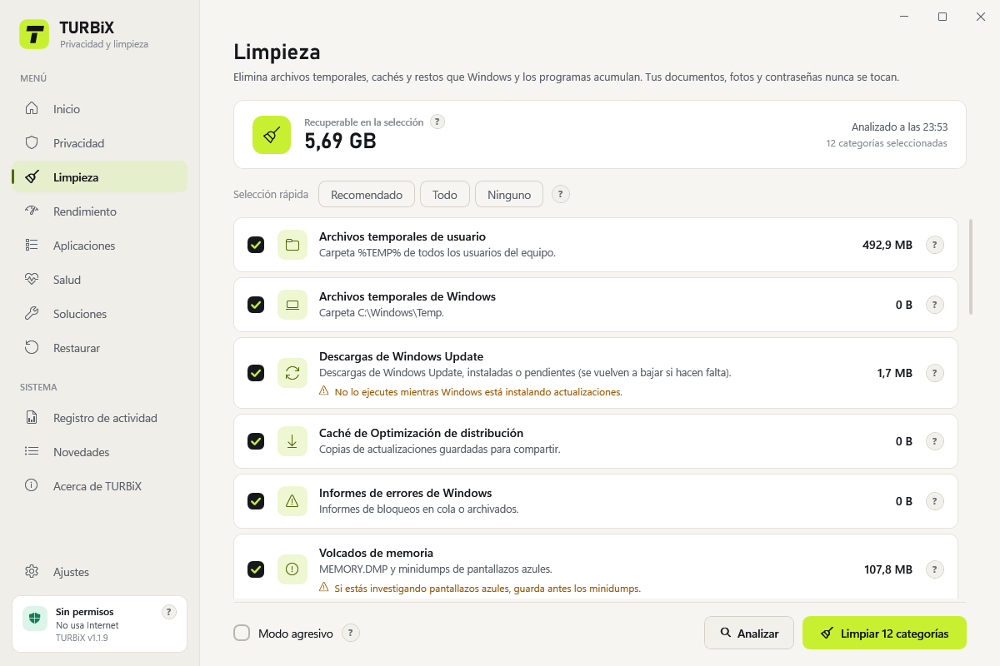
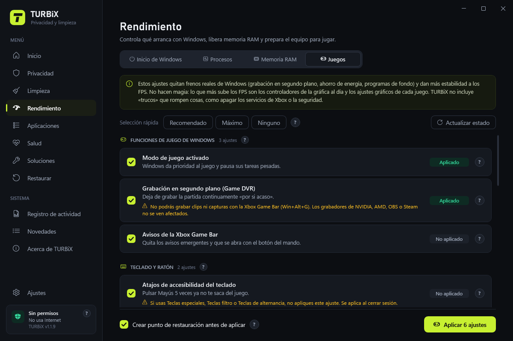
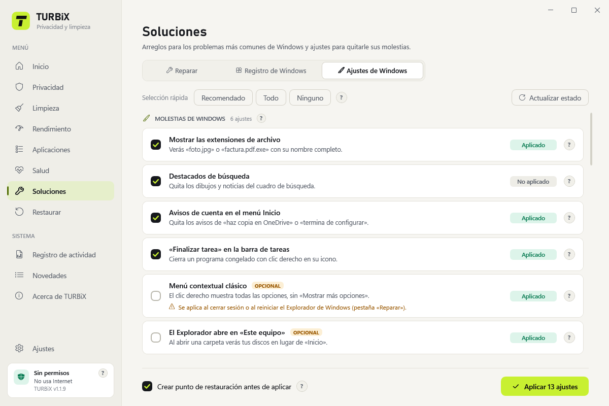

<p align="center">
  
</p>

<p align="center">
  <a href="README.md">English</a> ·
  <b>Español</b> ·
  <a href="README.pt-BR.md">Português (Brasil)</a> ·
  <a href="README.fr.md">Français</a> ·
  <a href="README.de.md">Deutsch</a> ·
  <a href="README.ru.md">Русский</a>
</p>

<p align="center"><sub>Libre y de código abierto · <a href="#colaborar">Colaborar</a> · <a href="#donaciones">Donar</a></sub></p>

# TURBiX

<p align="center">
  <a href="https://github.com/JulianR87/TURBiX/releases/latest"></a>
  <a href="https://github.com/JulianR87/TURBiX/releases"></a>
  <a href="LICENSE"></a>
  
</p>

<p align="center"><b><a href="https://github.com/JulianR87/TURBiX/releases/latest">Descargar la última versión</a></b></p>

TURBiX es un programa gratuito y de código abierto para **Windows 10 y Windows 11** que hace cuatro cosas:

- **Desactiva la telemetría** y la recopilación de datos de Windows y de los programas más comunes.
- **Mejora el rendimiento**: controla qué arranca con Windows, libera memoria RAM y prepara el equipo para jugar.
- **Diagnostica y repara**: detecta por qué el equipo va lento y aplica las reparaciones habituales de Windows.
- **Limpia archivos temporales, cachés y restos** que ocupan espacio sin motivo.

Es un único `TURBiX.exe`. Se puede usar sin instalar (también hay un instalador para quien lo prefiera) y no hay que descargar nada más: usa .NET Framework 4.6.2, que ya viene incluido en Windows 10 (1607 o posterior) y en Windows 11. Funciona en equipos de 32 y 64 bits y no usa Internet.

<p align="center">
  
  
</p>
<p align="center">
  
  
</p>

## Contenido

- [De un vistazo](#de-un-vistazo)
- [Qué hace](#qué-hace)
- [Ajustes, icono junto al reloj y segundo plano](#ajustes-icono-junto-al-reloj-y-segundo-plano)
- [Restaurar, registro de actividad y novedades](#restaurar-registro-de-actividad-y-novedades)
- [Seguridad](#seguridad)
- [Requisitos](#requisitos)
- [Descarga y uso](#descarga-y-uso)
- [Idiomas](#idiomas)
- [Dónde guarda sus datos](#dónde-guarda-sus-datos)
- [Opciones de línea de comandos](#opciones-de-línea-de-comandos)
- [Preguntas frecuentes](#preguntas-frecuentes)
- [Limitaciones conocidas](#limitaciones-conocidas)
- [Compilar](#compilar)
- [Marca](#marca)
- [Colaborar](#colaborar)
- [Licencia](#licencia)

## De un vistazo

- **Todo se puede deshacer.** Antes de cambiar algo, TURBiX guarda cómo estaba. La sección **Restaurar** devuelve cada sesión de cambios a su estado anterior.
- **Cada opción se explica.** Todas llevan un botón **?** que cuenta en pocas líneas qué hace y qué efecto tiene.
- **Primero mira, después toca.** La limpieza, el diagnóstico, la salud y el registro se analizan sin modificar nada, tú decides qué aplicar.
- **Honesto.** No promete milagros: si el problema es un disco viejo o poca memoria, lo dice. Tampoco incluye «trucos» que rompen cosas.
- **No usa Internet.** No descarga nada, no envía datos, no tiene cuentas ni publicidad.
- **No toca la seguridad.** Windows Update, Microsoft Defender, SmartScreen y el firewall quedan como están.
- **Probado en máquinas virtuales limpias.** Cada versión se prueba en un Windows 10 y 11 recién instalados, con poco hardware a propósito (Windows 10 con 2 núcleos y 2 GB de RAM, Windows 11 con 2 núcleos y 4 GB, su mínimo) para que se parezca a un equipo modesto. Con la optimización completa aplicada, en Windows 10 la memoria en reposo bajó un 31 % (de 1000 a 694 MB), los procesos un 28 % (de 88 a 63) y los servicios un 18 % (de 97 a 80), con 1,1 GB de disco liberado. En Windows 11 la memoria bajó un 22 % (de 2019 a 1580 MB), los procesos un 14 % (de 129 a 112) y los servicios un 7 % (de 88 a 82), con 3,1 GB liberados. El arranque casi no cambió en ninguno. Son cifras aproximadas, sacadas de un entorno virtual, así que según tu hardware pueden salir mejores o peores. En una PC física suelen salir mejores, aunque eso no lo medimos.
- **Seis idiomas**, modo claro y oscuro, y un icono junto al reloj con atajos.

## Qué hace

### Privacidad y telemetría

| Grupo | Qué cubre |
|---|---|
| Telemetría de Windows | Nivel de datos de diagnóstico, servicios DiagTrack y dmwappushservice, 10 tareas programadas de recopilación, CEIP e inventario, informe de errores, solicitudes de comentarios |
| Privacidad | ID de publicidad, historial de actividad, experiencias personalizadas, datos de escritura a mano y tecleo, lista de idiomas para sitios web, diagnóstico de apps\*, seguimiento de apps iniciadas\*, reconocimiento de voz en línea\*, ubicación\* |
| Anuncios y sugerencias | Búsqueda web en el menú Inicio, apps sugeridas, consejos y anuncios en Inicio, pantalla de bloqueo y Explorador |
| Inteligencia artificial | Copilot y Recall\* |
| Aplicaciones | Telemetría de Office, de NVIDIA (si está instalado), de herramientas de desarrollo (.NET, PowerShell, VS Code…), de Microsoft Edge\* y Optimización de distribución entre equipos de Internet\* |

\* Ajustes **avanzados**: solo se marcan con el perfil «Máximo» porque pueden desactivar alguna función. Su aviso aparece en amarillo.

### Limpieza

Temporales de usuario y de Windows · descargas de Windows Update · caché de Optimización de distribución · informes de errores · volcados de memoria · registros del sistema · caché de Internet · caché de navegadores (Chrome, Edge, Brave, Vivaldi, Opera, Firefox) · caché de apps (Discord, Teams, Spotify, Steam, Slack, VS Code) · caché de la Microsoft Store · caché DNS.

Opcionales: caché de sombreadores · miniaturas · instaladores de controladores · papelera · elementos recientes · Prefetch · registros de eventos · limpieza de WinSxS con DISM · instalación anterior de Windows (Windows.old y restos de actualizaciones, con el Liberador de espacio de Windows).

Primero se **analiza** (solo lectura) y se muestra cuánto ocupa cada categoría, después decides qué limpiar.

### Rendimiento

- **Inicio de Windows.** Lista los programas que se abren solos al iniciar sesión (registro, carpeta Inicio y apps de Microsoft Store) y permite activarlos o desactivarlos con un interruptor. Usa el mismo mecanismo que el Administrador de tareas: no desinstala nada.
- **Procesos.** Todos los procesos abiertos, como en el Administrador de tareas, con procesador, memoria y subprocesos. Los procesos que abre cada programa se despliegan debajo de él, cada «Host de servicio» dice qué servicio ejecuta y se puede finalizar una tarea (los procesos que Windows necesita están bloqueados).
- **Memoria RAM.** Uso en vivo, programas que más ocupan, botón para liberar memoria (recorta los conjuntos de trabajo y vacía la lista en espera) y limpieza automática cada 5, 10, 15, 30 o 60 minutos mientras TURBiX está abierto, aunque sea solo junto al reloj. Avisa con una notificación de Windows cuánta memoria liberó. Liberar memoria ayuda cuando está casi llena, no acelera un equipo al que le sobra.
- **Juegos.** 13 ajustes: Modo de juego, grabación en segundo plano (Game DVR), avisos de la Game Bar, atajos de accesibilidad, aceleración del ratón\*, prioridad multimedia, programación de GPU por hardware\*, plan «Alto rendimiento»\*, limitación de energía\*, Edge en segundo plano, apps de la Store en segundo plano\*, widgets\* y efectos visuales\*.

Se dejan fuera a propósito los «trucos» que rompen cosas o no hacen nada: apagar los servicios de Xbox, SysMain o el archivo de paginación, cambios de `bcdedit` y cualquier cosa que debilite la seguridad.

### Red

- **Tráfico.** Qué programas usan la red y cuánto bajan y suben, en vivo y en total, agrupado por programa. Cada «Host de servicio» dice qué servicio de Windows es. Cuenta solo tráfico de red real (el que no sale del propio equipo se ignora) y necesita permisos de administrador.
- **Conexiones.** Cada conexión TCP con su programa, dirección y puerto remotos, el servicio (HTTPS, DNS…), si va a Internet, a la red local o a este equipo, y su estado. Se puede cerrar una conexión con un clic (solo IPv4). El programa puede abrir otra.
- **Puertos abiertos.** Quién escucha, y si solo se alcanza desde este equipo o está abierto a la red. Los puertos delicados (compartir archivos, escritorio remoto, bases de datos…) se marcan para revisar.
- **Bloqueos.** Bloquea un programa, una dirección IP o un puerto con reglas del Firewall de Windows, agrupadas en «TURBiX». Aparecen en la pestaña Bloqueos y se quitan con «Desbloquear». TURBiX no bloquea componentes de Windows, a sí mismo, tu router ni tus servidores DNS, porque cortaría tu propia conexión. Las reglas siguen en el Firewall aunque desinstales TURBiX, así que desbloquea antes. No usa Internet: no resuelve nombres de equipos.

### Aplicaciones

- **Apps de Windows.** Quita las apps preinstaladas de una lista conocida (juegos y apps de promoción, Solitario, Clipchamp, Noticias, Cortana, Skype…) con el administrador de paquetes de Windows, sin PowerShell. Nunca ofrece la Tienda, Xbox, la Calculadora, «Obtener ayuda» ni componentes del sistema. No se revierte desde «Restaurar»: se reinstalan desde Microsoft Store.
- **Programas instalados.** La lista de Configuración › Aplicaciones, con tamaño y buscador. «Desinstalar» abre el desinstalador oficial de cada programa.

### Salud

Estado de cada componente según lo que informa a Windows: discos (S.M.A.R.T.: salud, desgaste, temperatura, horas de uso, errores), batería (capacidad respecto a nueva y ciclos), memoria RAM, procesador (errores de hardware WHEA, temperatura si el equipo la expone), tarjeta gráfica y antigüedad de su controlador, dispositivos con problemas de controlador, y pantallazos azules, apagados inesperados y errores de disco de los últimos 30 días. Solo lectura.


### Soluciones

- **Diagnóstico** (en la pantalla de inicio). Revisa las causas más comunes de un PC lento: disco mecánico o con fallos, poco espacio, poca memoria, demasiados programas al inicio, días sin reiniciar, reinicio pendiente y plan de energía. Solo lee, cada punto explica qué hacer.
- **Reparar.** Las reparaciones estándar de Windows con un botón: SFC, DISM RestoreHealth, comprobación de disco (`chkdsk /scan`), restablecer la red, desatascar la cola de impresión y reiniciar el Explorador.
- **Registro de Windows.** Busca entradas que apuntan a archivos que ya no existen (inicios rotos, programas fantasma en la lista de desinstalar, rutas y bibliotecas de programas borrados, caché de nombres) y las quita guardando antes una copia restaurable. Solo marca lo que se puede comprobar, no toca clases COM ni asociaciones de archivos.
- **Ajustes de Windows.** Extensiones de archivo visibles, destacados de búsqueda, avisos de cuenta en Inicio, «Finalizar tarea» en la barra de tareas, menú contextual clásico\*, Explorador en «Este equipo»\*, Sensor de almacenamiento, Inicio rápido\*, hibernación\* y SysMain en discos mecánicos\* (solo se ofrece si Windows está en un HDD). Barra de tareas e Inicio: acceso directo de Edge tras actualizar, botones de Reunirse ahora, Chat y Cortana, Vista de tareas\*, búsqueda como icono\*, barra a la izquierda\*, archivos recientes\* y archivos ocultos\*. Servicios opcionales: Fax, modo tienda, mapas sin conexión, uso compartido de Windows Media Player, Windows Insider\*, asistente de compatibilidad\*, cola de impresión\* e indexación de búsqueda\*.


## Ajustes, icono junto al reloj y segundo plano

La página **Ajustes** reúne todo lo que se puede configurar del propio TURBiX:

- **Apariencia e idioma.** Tema claro, oscuro o el mismo que Windows. El idioma sigue al de Windows, pero se puede elegir otro a mano.
- **Abrir TURBiX al iniciar Windows.** Se queda junto al reloj, sin abrir la ventana, para que la limpieza automática de memoria esté siempre activa. Como TURBiX necesita permisos de administrador, usa una tarea del Programador de tareas llamada «TURBiX», que se borra al desactivar la opción.
- **Icono junto al reloj.** Doble clic abre la ventana. Con el botón derecho: abrir TURBiX, liberar memoria RAM, limpiar archivos temporales, abrir Ajustes o salir. Las acciones del menú avisan del resultado con una notificación de Windows.
- **Seguir funcionando al cerrar la ventana.** La X esconde la ventana y TURBiX queda junto al reloj. Para cerrarlo del todo se usa «Salir de TURBiX», que pide confirmación (se puede desactivar).
- **Limpieza automática de memoria.** Cada cuánto, solo si el uso supera el 80 % y si avisa cada vez.
- **Datos.** Abrir la carpeta de datos y volver todas las opciones a como vienen.

Si TURBiX ya está abierto y se vuelve a abrir, aparece la ventana que ya estaba en lugar de una segunda copia. Con la ventana escondida apenas usa el procesador: solo revisa la memoria cada 30 segundos.

## Restaurar, registro de actividad y novedades

- **Restaurar.** Cada vez que aplicas ajustes o reparas el registro se crea una sesión con la copia de lo que había. Desde aquí se revierte la sesión completa con un clic. También abre «Restaurar sistema» de Windows.
- **Registro de actividad.** Todo lo que TURBiX hace queda anotado, con hora y resultado, en un archivo por día. Se puede copiar o abrir la carpeta.
- **Novedades.** Los cambios de cada versión, dentro del programa y en el idioma de la interfaz. Es el mismo contenido que [`CHANGELOG.md`](CHANGELOG.md).

## Seguridad

- **Nunca** se desactiva Windows Update, Microsoft Defender, SmartScreen ni el firewall, ni se modifica el archivo `hosts`.
- Antes de cambiar un valor se guarda el original en `C:\ProgramData\TURBiX\Backups`. Desde la sección **Restaurar** puedes revertir cada sesión con un clic.
- Opcionalmente crea un **punto de restauración** de Windows antes de aplicar.
- Navegadores: solo se borra la caché. Las cookies, contraseñas, el historial y las sesiones abiertas no se tocan.
- Si un programa está abierto, su caché se omite. Los temporales de menos de 24 horas se conservan, salvo que actives el modo agresivo.
- El limpiador nunca sigue enlaces simbólicos ni uniones de carpetas.
- Todo queda anotado en `C:\ProgramData\TURBiX\Logs`.
- TURBiX no se conecta a Internet ni envía ningún dato.

## Requisitos

- Windows 10 versión 1607 o posterior, o Windows 11. 32 o 64 bits.
- .NET Framework 4.6.2 o posterior, que ya viene con esas versiones de Windows. No hay que instalar nada.
- Una cuenta con permisos de administrador.
- No necesita conexión a Internet. Única excepción, avisada en pantalla: la reparación `DISM /RestoreHealth` puede hacer que *Windows* descargue archivos de Windows Update.

## Descarga y uso

Hay dos formas de usarlo, las dos desde la sección [Releases](../../releases):

- **Instalador (`TURBiX-Setup.exe`).** Copia TURBiX a `Archivos de programa`, crea el acceso directo en el menú Inicio (y en el escritorio, si quieres) y lo agrega a la lista de aplicaciones de Windows, desde donde se desinstala como cualquier otro programa.
- **Portable (`TURBiX.exe`).** La versión que no se instala: un solo archivo que ejecutas desde cualquier carpeta o desde un USB.

En los dos casos, Windows pedirá permisos de administrador, porque son necesarios para cambiar la configuración del sistema. Después, empieza por **Optimización rápida** o revisa cada sección.

Desinstalar TURBiX no deshace los cambios que aplicó en Windows: si quieres volver atrás, usa antes la sección **Restaurar**. Las copias de seguridad quedan en `C:\ProgramData\TURBiX`.

> **Aviso de SmartScreen.** Mientras el ejecutable no tenga firma digital, Windows puede mostrar «Windows protegió su PC». Pulsa *Más información → Ejecutar de todas formas*. Si lo prefieres, compílalo tú mismo desde el código.

> **Antivirus.** Algún antivirus puede marcar TURBiX por error con una detección genérica: es un programa nuevo, sin firma, que pide permisos de administrador y cambia la configuración de Windows. TURBiX no se conecta a Internet y todo su código está en este repositorio. Si te pasa, puedes comprobar el archivo en VirusTotal, compilarlo tú mismo o avisar en [Issues](../../issues) para que lo reportemos al fabricante.

> **Varios usuarios.** Los ajustes por usuario (por ejemplo, el ID de publicidad) se aplican a la cuenta que ejecuta TURBiX. En un equipo con varias cuentas, ejecútalo desde cada una.

## Idiomas

TURBiX se muestra solo en el idioma de Windows: **español, inglés, portugués (Brasil), francés, alemán y ruso**. Con cualquier otro idioma se muestra en inglés. Desde **Ajustes** se puede elegir uno distinto, el cambio se ve al volver a abrir TURBiX.

Los textos están en archivos de texto sencillos (`src/Turbix/Strings/<área>.<idioma>.txt`), uno por idioma. La guía para corregir o agregar una traducción está en [`tools/TRADUCIR.md`](tools/TRADUCIR.md).

## Dónde guarda sus datos

| Qué | Dónde |
| --- | --- |
| Copias de seguridad de cada cambio | `C:\ProgramData\TURBiX\Backups` |
| Registro de actividad (un archivo por día) | `C:\ProgramData\TURBiX\Logs` |
| Preferencias (tema, idioma, opciones de Ajustes) | Registro: `HKEY_CURRENT_USER\Software\TURBiX` |
| Inicio con Windows | Tarea «TURBiX» del Programador de tareas |
| Programa instalado (solo con el instalador) | `C:\Program Files\TURBiX` |

La carpeta de `ProgramData` solo la pueden modificar los administradores. TURBiX no guarda nada más y no escribe fuera de estos lugares, aparte de los cambios que tú decides aplicar.

## Opciones de línea de comandos

| Opción | Qué hace |
| --- | --- |
| `--lang es\|en\|pt\|fr\|de\|ru` | Abre TURBiX en ese idioma, sin cambiar la preferencia guardada. |
| `--startup` | Arranca junto al reloj, sin mostrar la ventana. Es lo que usa la tarea de inicio. |
| `--uninstall` | Desinstala la copia instalada. Es lo que llama Windows desde Configuración › Aplicaciones. |
| `TURBiX-Setup.exe --silent` | Instala sin mostrar ninguna ventana (para gestores de paquetes e instalaciones desatendidas). Con `--no-desktop` no crea el acceso directo del escritorio. |
| `--uninstall --silent` | Desinstala sin preguntar. |

## Preguntas frecuentes

**¿TURBiX va a hacer que mi PC vuele?**
Depende de qué la frene. Quitar programas del inicio, liberar espacio y apagar servicios que no usas se nota. Si el problema es un disco mecánico o poca memoria, TURBiX te lo dice, pero eso solo se arregla cambiando la pieza.

**¿Puedo deshacer lo que hice?**
Sí, desde **Restaurar**, por sesión completa. Dos cosas no se revierten desde ahí: los archivos borrados en Limpieza y las apps de Windows quitadas, que se vuelven a instalar desde Microsoft Store. La interfaz lo avisa antes de confirmar.

**¿Es seguro limpiar el registro?**
TURBiX solo quita entradas que apuntan a archivos que comprobó que ya no existen, y guarda antes una copia. No «optimiza» ni compacta el registro, y lo dice claro: limpiar el registro no acelera el equipo.

**¿Por qué pide permisos de administrador?**
Porque casi todo lo que hace (servicios, tareas programadas, configuración del sistema, limpieza de carpetas de Windows) lo exige.

**¿Tengo que dejarlo abierto?**
No. Los ajustes quedan aplicados aunque cierres TURBiX. Solo hace falta que siga abierto junto al reloj si quieres la limpieza automática de memoria.

**¿Envía algún dato?**
Ninguno. TURBiX no tiene código de red: ni estadísticas, ni actualizaciones automáticas, ni cuentas.

**¿Cómo actualizo?**
Descarga la versión nueva. Con el instalador, instala encima: conserva ajustes y copias de seguridad. Con la versión portable, reemplaza el archivo.

## Limitaciones conocidas

- Una tarea larga no se puede cancelar a mitad, mientras trabaja, TURBiX no deja cerrarse.
- Se revierte la sesión completa, no un ajuste suelto.
- Si TURBiX se abre con una cuenta de administrador distinta de la tuya, los ajustes por usuario se aplican a esa cuenta. El diagnóstico lo avisa.
- «Inicio de Windows» no lista las tareas programadas que se ejecutan al iniciar sesión.
- Los registros de actividad y las copias antiguas no se borran solos.

## Compilar

Necesitas el [SDK de .NET](https://dotnet.microsoft.com/download) (6 o posterior). Los ensamblados de referencia de .NET Framework se descargan solos.

```cmd
build.cmd
```

Quedan dos archivos en `dist`: `TURBiX.exe` (portable) y `TURBiX-Setup.exe` (instalador, que lleva dentro el mismo `TURBiX.exe`). Para compilar solo el programa también puedes usar `dotnet build src\Turbix -c Release`.

El programa es C# con WPF sobre .NET Framework 4.6.2, sin paquetes externos y sin PowerShell: un único exe sin dependencias.

### Estructura

```
src/Turbix/
  Core/          Registro, servicios, tareas, copias, memoria, procesos, salud, instalador
  Tweaks/        Catálogos de ajustes (privacidad, juegos y Windows) y motor que los aplica y revierte
  Cleanup/       Catálogo de limpieza y motor de análisis y borrado
  ViewModels/    Lógica de la interfaz (MVVM)
  Views/         Páginas WPF, diálogos, icono junto al reloj y ventana del instalador
  Controls/      Botón de ayuda «?», anillo de progreso y conversores
  Themes/        Paletas clara y oscura, tipografía, estilos y cambio de tema
  Localization/  Carga de textos y plurales por idioma
  Strings/       Textos de la interfaz, un archivo por área e idioma
  Changelog/     «Novedades» traducido (el español es CHANGELOG.md)
tools/           Comprobador de textos y guía de traducción
assets/brand/    Logotipo y banner
```

Para añadir un ajuste, edita `Tweaks/TweakCatalog.cs` (privacidad), `GamingCatalog.cs` o `WindowsCatalog.cs`. Cada ajuste es una lista de acciones de registro, servicio o tarea, y el motor se encarga de la copia y la reversión. Para añadir una categoría de limpieza, edita `Cleanup/CleanupCatalog.cs`. Todo texto visible va en `Strings`, en los seis idiomas, `python tools/check_strings.py` comprueba que no falte ninguno.

## Marca

El logotipo es una «T» de estilo stencil inclinada sobre una baldosa lima (`#C8F031`) con tinta casi negra (`#12140F`). La tipografía de títulos es Bahnschrift, que viene incluida en Windows. Los archivos están en [`assets/brand`](assets/brand).

## Colaborar

TURBiX es un proyecto público, gratuito y sin publicidad. No recopila datos ni tiene versión de pago: se mantiene con tiempo libre y con la ayuda de quienes lo usan. Toda colaboración suma, y no hace falta saber programar:

- **Avisa de un error o propón una mejora** en [Issues](../../issues). Cuanto más detalle (versión de Windows, qué hiciste, qué esperabas), más fácil es arreglarlo.
- **Mejora una traducción.** Los textos están en `src/Turbix/Strings` y la guía en [`tools/TRADUCIR.md`](tools/TRADUCIR.md).
- **Envía código** con un *pull request*: un ajuste nuevo, una categoría de limpieza o un arreglo.
- **Cuéntaselo a alguien** a quien le pueda servir. Es la mejor forma de que el proyecto crezca.

### Donaciones

Si TURBiX te ahorró tiempo o te devolvió un equipo que andaba lento, puedes apoyar su desarrollo con una donación. Es totalmente voluntaria: el programa es y seguirá siendo gratuito, con o sin ella.

| Moneda | Red | Dirección |
| --- | --- | --- |
| **Bitcoin (BTC)** | Bitcoin | `bc1q527vjd3vcj6vwg6dg8g0dengh6hd9944l73jqe` |
| **Ethereum (ETH)** | BEP20 (BNB Smart Chain) | `0xC1162610b1A6b8532f4233Db598F624D8EF4d2C4` |
| **Tether (USDT)** | BEP20 (BNB Smart Chain) | `0xC1162610b1A6b8532f4233Db598F624D8EF4d2C4` |

> **Importante: revisa la red antes de enviar.** BTC solo por la red Bitcoin, ETH y USDT solo por la red BEP20. Un envío por otra red se pierde y no se puede recuperar.

Gracias por ayudar a que TURBiX siga siendo libre.

## Licencia

[MIT](LICENSE). Microsoft, Windows, Edge, Office y Copilot son marcas de Microsoft Corporation. TURBiX no está afiliado a Microsoft.
