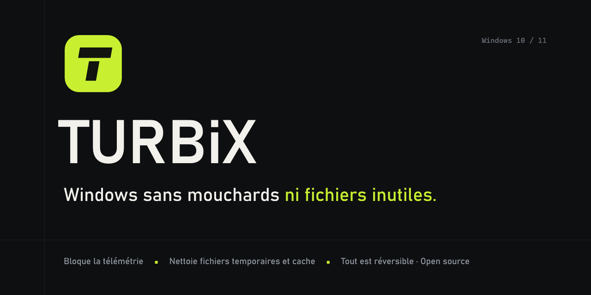
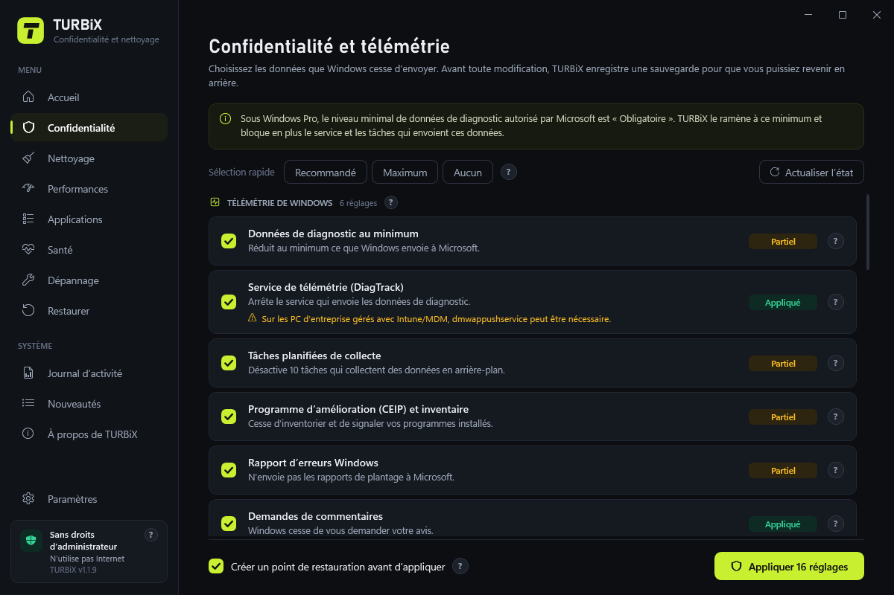
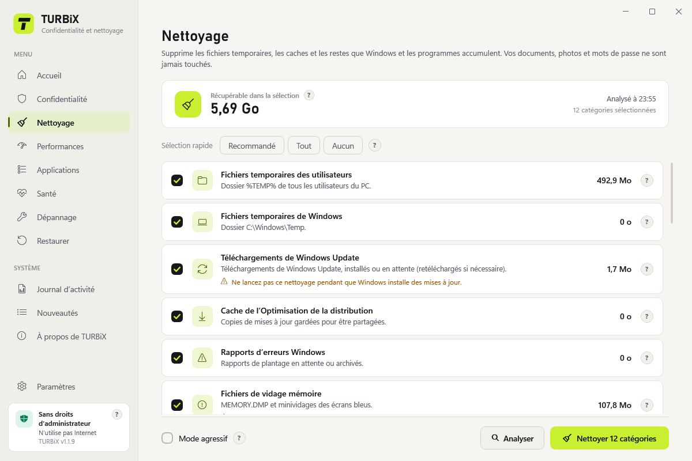
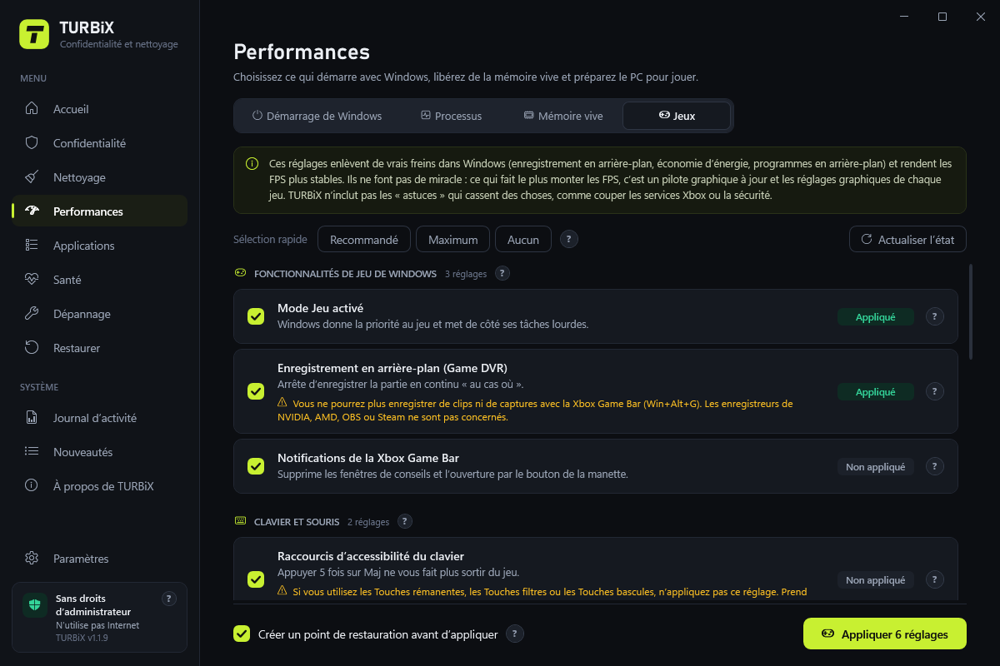
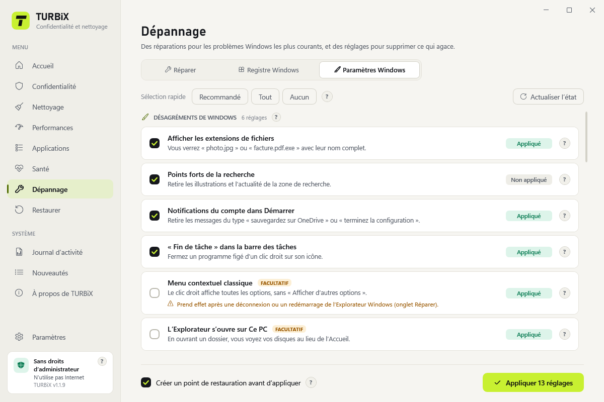

<p align="center">
  
</p>

<p align="center">
  <a href="README.md">English</a> ·
  <a href="README.es.md">Español</a> ·
  <a href="README.pt-BR.md">Português (Brasil)</a> ·
  <b>Français</b> ·
  <a href="README.de.md">Deutsch</a> ·
  <a href="README.ru.md">Русский</a>
</p>

<p align="center"><sub>Libre et open source · <a href="#contribuer">Contribuer</a> · <a href="#dons">Faire un don</a></sub></p>

# TURBiX

<p align="center">
  <a href="https://github.com/JulianR87/TURBiX/releases/latest"></a>
  <a href="https://github.com/JulianR87/TURBiX/releases"></a>
  <a href="LICENSE"></a>
  
</p>

<p align="center"><b><a href="https://github.com/JulianR87/TURBiX/releases/latest">Télécharger la dernière version</a></b></p>

TURBiX est un programme gratuit et open source pour **Windows 10 et Windows 11** qui fait quatre choses :

- **Il désactive la télémétrie** et la collecte de données de Windows et des programmes les plus courants.
- **Il améliore les performances** : il contrôle ce qui démarre avec Windows, libère de la mémoire vive et prépare le PC pour jouer.
- **Il diagnostique et répare** : il trouve pourquoi le PC est lent et lance les réparations habituelles de Windows.
- **Il nettoie les fichiers temporaires, les caches et les restes** qui occupent de la place pour rien.

C’est un seul fichier, `TURBiX.exe`. Il s’utilise sans installation (il existe aussi un programme d’installation pour ceux qui préfèrent) et il n’y a rien d’autre à télécharger : il utilise .NET Framework 4.6.2, déjà inclus dans Windows 10 (1607 ou ultérieur) et dans Windows 11. Il fonctionne sur les PC 32 et 64 bits et n’utilise pas Internet.

<p align="center">
  
  
</p>
<p align="center">
  
  
</p>

## Sommaire

- [En bref](#en-bref)
- [Ce que fait TURBiX](#ce-que-fait-turbix)
- [Paramètres, icône à côté de l’horloge et arrière-plan](#paramètres-icône-à-côté-de-lhorloge-et-arrière-plan)
- [Restaurer, journal d’activité et nouveautés](#restaurer-journal-dactivité-et-nouveautés)
- [Sécurité](#sécurité)
- [Configuration requise](#configuration-requise)
- [Téléchargement et utilisation](#téléchargement-et-utilisation)
- [Langues](#langues)
- [Où TURBiX enregistre ses données](#où-turbix-enregistre-ses-données)
- [Options de ligne de commande](#options-de-ligne-de-commande)
- [Questions fréquentes](#questions-fréquentes)
- [Limites connues](#limites-connues)
- [Compiler](#compiler)
- [Marque](#marque)
- [Contribuer](#contribuer)
- [Licence](#licence)

## En bref

- **Tout peut être annulé.** Avant de modifier quoi que ce soit, TURBiX enregistre l’état d’origine. La section **Restaurer** remet chaque session de modifications comme elle était avant.
- **Chaque option est expliquée.** Toutes ont un bouton **?** qui dit en quelques lignes ce qu’elle fait et quel effet elle a.
- **D’abord regarder, ensuite agir.** Le nettoyage, le diagnostic, la santé et le Registre sont analysés sans rien modifier, c’est vous qui décidez quoi appliquer.
- **Honnête.** Pas de promesses miracles : si le problème vient d’un vieux disque ou d’un manque de mémoire, TURBiX le dit. Il ne contient pas non plus d’« astuces » qui cassent des choses.
- **N’utilise pas Internet.** Il ne télécharge rien, n’envoie aucune donnée, n’a ni comptes ni publicité.
- **Ne touche pas à la sécurité.** Windows Update, Microsoft Defender, SmartScreen et le pare-feu restent tels quels.
- **Testé sur des machines virtuelles propres.** Chaque version est essayée sur un Windows 10 et 11 fraîchement installés, avec peu de matériel volontairement (Windows 10 avec 2 cœurs et 2 Go de RAM, Windows 11 avec 2 cœurs et 4 Go, son minimum) pour ressembler à un PC modeste. Avec l’optimisation complète appliquée, sous Windows 10 la mémoire au repos a baissé de 31 % (de 1000 à 694 Mo), les processus de 28 % (de 88 à 63) et les services de 18 % (de 97 à 80), avec 1,1 Go de disque libéré. Sous Windows 11, la mémoire a baissé de 22 % (de 2019 à 1580 Mo), les processus de 14 % (de 129 à 112) et les services de 7 % (de 88 à 82), avec 3,1 Go libérés. Le démarrage a à peine changé dans les deux cas. Ces chiffres sont approximatifs et viennent d’un environnement virtuel : selon votre matériel, ils peuvent être meilleurs ou moins bons. Sur un PC physique, ils sont généralement meilleurs, mais nous ne l’avons pas mesuré.
- **Six langues**, mode clair et sombre, et une icône à côté de l’horloge avec des raccourcis.

## Ce que fait TURBiX

### Confidentialité et télémétrie

| Groupe | Ce qu’il couvre |
|---|---|
| Télémétrie de Windows | Niveau des données de diagnostic, services DiagTrack et dmwappushservice, 10 tâches planifiées de collecte, CEIP et inventaire, rapport d’erreurs, demandes de commentaires |
| Confidentialité | Identifiant de publicité, historique des activités, expériences personnalisées, données d’écriture manuscrite et de saisie, liste des langues pour les sites web, diagnostics des applications\*, suivi des applications ouvertes\*, reconnaissance vocale en ligne\*, localisation\* |
| Publicités et suggestions | Recherche web dans le menu Démarrer, applications suggérées, conseils et publicités dans Démarrer, sur l’écran de verrouillage et dans l’Explorateur |
| Intelligence artificielle | Copilot et Recall\* |
| Applications | Télémétrie d’Office, de NVIDIA (s’il est installé), des outils de développement (.NET, PowerShell, VS Code…), de Microsoft Edge\* et Optimisation de la distribution avec des PC sur Internet\* |

\* Réglages **avancés** : ils ne sont cochés qu’avec le profil « Maximum », car ils peuvent désactiver une fonction. Leur avertissement s’affiche en jaune.

### Nettoyage

Fichiers temporaires des utilisateurs et de Windows · téléchargements de Windows Update · cache de l’Optimisation de la distribution · rapports d’erreurs · fichiers de vidage mémoire · fichiers journaux du système · cache Internet · cache des navigateurs (Chrome, Edge, Brave, Vivaldi, Opera, Firefox) · cache des applications (Discord, Teams, Spotify, Steam, Slack, VS Code) · cache du Microsoft Store · cache DNS.

Facultatifs : cache des shaders · miniatures · installateurs de pilotes · Corbeille · éléments récents · Prefetch · journaux d’événements · nettoyage de WinSxS avec DISM · installation précédente de Windows (Windows.old et restes de mises à jour, avec le Nettoyage de disque de Windows).

TURBiX commence par **analyser** (lecture seule) et affiche la place occupée par chaque catégorie, vous décidez ensuite quoi nettoyer.

### Performances

- **Démarrage de Windows.** Affiche les programmes qui s’ouvrent tout seuls à l’ouverture de session (Registre, dossier Démarrage et applications du Microsoft Store) et permet de les activer ou de les désactiver avec un interrupteur. C’est le même mécanisme que celui du Gestionnaire des tâches : rien n’est désinstallé.
- **Processus.** Tous les processus ouverts, comme dans le Gestionnaire des tâches, avec processeur, mémoire et threads. Les processus lancés par chaque programme se déplient en dessous de lui, chaque « Hôte de service » indique quel service il exécute, et vous pouvez arrêter une tâche (les processus dont Windows a besoin sont verrouillés).
- **Mémoire vive.** Utilisation en direct, programmes qui en occupent le plus, bouton pour libérer la mémoire (il réduit les plages de travail et vide la mémoire en attente) et nettoyage automatique toutes les 5, 10, 15, 30 ou 60 minutes tant que TURBiX est ouvert, même s’il n’est qu’à côté de l’horloge. Une notification Windows indique la quantité de mémoire libérée. Libérer la mémoire aide quand elle est presque pleine, cela n’accélère pas un PC qui en a largement assez.
- **Jeux.** 13 réglages : Mode Jeu, enregistrement en arrière-plan (Game DVR), notifications de la Game Bar, raccourcis d’accessibilité, accélération de la souris\*, priorité multimédia, planification du GPU à accélération matérielle\*, mode « Performances élevées »\*, limitation de l’alimentation\*, Edge en arrière-plan, applications du Store en arrière-plan\*, widgets\* et effets visuels\*.

Sont laissées de côté, volontairement, les « astuces » qui cassent des choses ou ne servent à rien : arrêter les services Xbox, SysMain ou le fichier d’échange, les modifications de `bcdedit` et tout ce qui affaiblit la sécurité.

### Réseau

- **Trafic.** Quels programmes utilisent le réseau et combien ils reçoivent et envoient, en direct et au total, regroupés par programme. Chaque « Hôte de service » indique de quel service Windows il s’agit. Seul le trafic réseau réel est compté (celui qui ne quitte pas le PC est ignoré) et les droits d’administrateur sont nécessaires.
- **Connexions.** Chaque connexion TCP avec son programme, l’adresse et le port distants, le service (HTTPS, DNS…), si elle va vers Internet, le réseau local ou ce PC, et son état. On peut fermer une connexion d’un clic (IPv4 uniquement). Le programme peut en ouvrir une autre.
- **Ports ouverts.** Qui écoute, et si le port n’est accessible que depuis ce PC ou ouvert au réseau. Les ports sensibles (partage de fichiers, bureau à distance, bases de données…) sont signalés à vérifier.
- **Blocages.** Bloque un programme, une adresse IP ou un port avec des règles du Pare-feu Windows, regroupées sous « TURBiX ». Elles apparaissent dans l’onglet Blocages et se retirent avec « Débloquer ». TURBiX ne bloque pas les composants de Windows, lui-même, votre routeur ni vos serveurs DNS, car cela couperait votre propre connexion. Les règles restent dans le Pare-feu même si vous désinstallez TURBiX : débloquez donc avant. Il n’utilise pas Internet : il ne résout pas les noms d’hôtes.

### Applications

- **Applications Windows.** Supprime les applications préinstallées d’une liste connue (jeux et applications promotionnels, Solitaire, Clipchamp, Actualités, Cortana, Skype…) avec le gestionnaire de packages de Windows, sans PowerShell. TURBiX ne propose jamais le Store, Xbox, la Calculatrice, « Obtenir de l’aide » ni les composants du système. Cela ne s’annule pas depuis « Restaurer » : elles se réinstallent depuis le Microsoft Store.
- **Programmes installés.** La liste de Paramètres › Applications, avec la taille et une recherche. « Désinstaller » ouvre le programme de désinstallation officiel de chaque programme.

### Santé

L’état de chaque composant d’après ce qu’il signale à Windows : disques (S.M.A.R.T. : santé, usure, température, heures d’utilisation, erreurs), batterie (capacité par rapport au neuf et cycles), mémoire vive, processeur (erreurs matérielles WHEA, température si le PC la communique), carte graphique et ancienneté de son pilote, périphériques avec un problème de pilote, ainsi que les écrans bleus, les arrêts inattendus et les erreurs de disque des 30 derniers jours. Lecture seule.


### Dépannage

- **Diagnostic** (sur l’écran d’accueil). Vérifie les causes les plus fréquentes d’un PC lent : disque mécanique ou défaillant, peu d’espace, peu de mémoire, trop de programmes au démarrage, jours sans redémarrage, redémarrage en attente et mode de gestion de l’alimentation. Il se contente de lire, chaque point explique quoi faire.
- **Réparer.** Les réparations standard de Windows en un bouton : SFC, DISM RestoreHealth, vérification du disque (`chkdsk /scan`), réinitialisation du réseau, déblocage de la file d’attente d’impression et redémarrage de l’Explorateur.
- **Registre Windows.** Recherche les entrées qui pointent vers des fichiers qui n’existent plus (démarrages cassés, programmes fantômes dans la liste de désinstallation, chemins et bibliothèques de programmes supprimés, cache de noms) et les supprime après en avoir enregistré une copie restaurable. Seul ce qui peut être vérifié est signalé, les classes COM et les associations de fichiers ne sont pas touchées.
- **Paramètres Windows.** Extensions de fichiers visibles, points forts de la recherche, notifications du compte dans Démarrer, « Fin de tâche » dans la barre des tâches, menu contextuel classique\*, Explorateur sur « Ce PC »\*, Assistant Stockage, démarrage rapide\*, mise en veille prolongée\* et SysMain sur disque mécanique\* (proposé uniquement si Windows est sur un HDD). Barre des tâches et Démarrer : raccourci Edge après une mise à jour, boutons Conversation instantanée, Conversation et Cortana, Affichage des tâches\*, recherche en icône\*, barre des tâches à gauche\*, fichiers récents\* et fichiers cachés\*. Services facultatifs : Télécopie, mode démonstration en magasin, cartes téléchargées, partage du Lecteur Windows Media, Windows Insider\*, Assistant Compatibilité des programmes\*, spouleur d’impression\* et indexation de la recherche\*.


## Paramètres, icône à côté de l’horloge et arrière-plan

La page **Paramètres** rassemble tout ce qui se règle dans TURBiX lui-même :

- **Apparence et langue.** Thème clair, sombre ou le même que Windows. La langue suit celle de Windows, mais vous pouvez en choisir une autre.
- **Ouvrir TURBiX au démarrage de Windows.** Il reste à côté de l’horloge, sans ouvrir la fenêtre, pour que le nettoyage automatique de la mémoire soit toujours actif. Comme TURBiX a besoin des droits d’administrateur, il utilise une tâche du Planificateur de tâches nommée « TURBiX », qui est supprimée quand vous désactivez l’option.
- **Icône à côté de l’horloge.** Un double-clic ouvre la fenêtre. Avec le clic droit : ouvrir TURBiX, libérer la mémoire vive, nettoyer les fichiers temporaires, ouvrir Paramètres ou quitter. Les actions du menu annoncent leur résultat par une notification Windows.
- **Continuer à fonctionner quand la fenêtre est fermée.** Le X masque la fenêtre et TURBiX reste à côté de l’horloge. Pour le fermer complètement, choisissez « Quitter TURBiX », qui demande une confirmation (désactivable).
- **Nettoyage automatique de la mémoire.** À quelle fréquence, seulement si l’utilisation dépasse 80 %, et avec ou sans notification à chaque fois.
- **Données.** Ouvrir le dossier de données et remettre toutes les options comme à l’origine.

Si TURBiX est déjà ouvert et que vous le lancez de nouveau, c’est la fenêtre existante qui s’affiche, pas une deuxième copie. Fenêtre masquée, il utilise à peine le processeur : il ne fait que vérifier la mémoire toutes les 30 secondes.

## Restaurer, journal d’activité et nouveautés

- **Restaurer.** Chaque fois que vous appliquez des réglages ou réparez le Registre, une session est créée avec la copie de ce qu’il y avait avant. D’ici, vous annulez la session entière en un clic. La page ouvre aussi la « Restauration du système » de Windows.
- **Journal d’activité.** Tout ce que fait TURBiX est noté, avec l’heure et le résultat, dans un fichier par jour. Vous pouvez le copier ou ouvrir le dossier.
- **Nouveautés.** Les changements de chaque version, dans le programme et dans la langue de l’interface. C’est le même contenu que [`src/Turbix/Changelog/fr.md`](src/Turbix/Changelog/fr.md).

## Sécurité

- TURBiX ne désactive **jamais** Windows Update, Microsoft Defender, SmartScreen ni le pare-feu, et ne modifie jamais le fichier `hosts`.
- Avant de modifier une valeur, l’originale est enregistrée dans `C:\ProgramData\TURBiX\Backups`. Depuis la section **Restaurer**, vous pouvez annuler chaque session en un clic.
- En option, il crée un **point de restauration** Windows avant d’appliquer.
- Navigateurs : seul le cache est supprimé. Les cookies, les mots de passe, l’historique et les sessions ouvertes ne sont pas touchés.
- Si un programme est ouvert, son cache est ignoré. Les fichiers temporaires de moins de 24 heures sont conservés, sauf si vous activez le mode agressif.
- Le nettoyage ne suit jamais les liens symboliques ni les jonctions de dossiers.
- Tout est noté dans `C:\ProgramData\TURBiX\Logs`.
- TURBiX ne se connecte pas à Internet et n’envoie aucune donnée.

## Configuration requise

- Windows 10 version 1607 ou ultérieure, ou Windows 11. 32 ou 64 bits.
- .NET Framework 4.6.2 ou ultérieur, déjà fourni avec ces versions de Windows. Il n’y a rien à installer.
- Un compte avec les droits d’administrateur.
- Aucune connexion Internet n’est nécessaire. Seule exception, signalée à l’écran : la réparation `DISM /RestoreHealth` peut amener *Windows* à télécharger des fichiers depuis Windows Update.

## Téléchargement et utilisation

Il y a deux façons de l’utiliser, toutes les deux depuis la section [Releases](../../releases) :

- **Programme d’installation (`TURBiX-Setup.exe`).** Il copie TURBiX dans `Program Files`, crée le raccourci dans le menu Démarrer (et sur le bureau, si vous le souhaitez) et l’ajoute à la liste des applications de Windows, d’où il se désinstalle comme n’importe quel autre programme.
- **Version portable (`TURBiX.exe`).** Un seul fichier qui se lance depuis n’importe quel dossier, sans rien installer.

Dans les deux cas, Windows demandera les droits d’administrateur, car ils sont nécessaires pour modifier les paramètres du système. Ensuite, commencez par **Optimisation rapide** ou parcourez chaque section.

Désinstaller TURBiX n’annule pas les modifications qu’il a appliquées à Windows : si vous voulez revenir en arrière, passez d’abord par la section **Restaurer**. Les sauvegardes restent dans `C:\ProgramData\TURBiX`.

> **Avertissement SmartScreen.** Tant que l’exécutable n’a pas de signature numérique, Windows peut afficher « Windows a protégé votre ordinateur ». Cliquez sur *Informations complémentaires → Exécuter quand même*. Si vous préférez, compilez-le vous-même à partir du code.

> **Antivirus.** Il arrive qu’un antivirus signale TURBiX à tort, avec une détection générique : c’est un programme nouveau, non signé, qui demande les droits d’administrateur et modifie les paramètres de Windows. TURBiX ne se connecte pas à Internet et tout son code se trouve dans ce dépôt. Si cela vous arrive, vous pouvez vérifier le fichier sur VirusTotal, le compiler vous-même ou le signaler dans [Issues](../../issues) pour que nous le déclarions à l’éditeur.

> **Plusieurs utilisateurs.** Les réglages propres à chaque utilisateur (par exemple, l’identifiant de publicité) s’appliquent au compte qui lance TURBiX. Sur un PC avec plusieurs comptes, lancez-le depuis chacun d’eux.

## Langues

TURBiX s’affiche de lui-même dans la langue de Windows : **espagnol, anglais, portugais (Brésil), français, allemand et russe**. Avec toute autre langue, il s’affiche en anglais. Vous pouvez en choisir une autre dans **Paramètres**, le changement est visible à la prochaine ouverture de TURBiX.

Les textes se trouvent dans de simples fichiers texte (`src/Turbix/Strings/<área>.<idioma>.txt`), un par langue. Le guide pour corriger ou ajouter une traduction est dans [`tools/TRANSLATING.fr.md`](tools/TRANSLATING.fr.md).

## Où TURBiX enregistre ses données

| Quoi | Où |
| --- | --- |
| Sauvegardes de chaque modification | `C:\ProgramData\TURBiX\Backups` |
| Journal d’activité (un fichier par jour) | `C:\ProgramData\TURBiX\Logs` |
| Préférences (thème, langue, options de Paramètres) | Registre : `HKEY_CURRENT_USER\Software\TURBiX` |
| Ouverture au démarrage de Windows | Tâche « TURBiX » du Planificateur de tâches |
| Programme installé (uniquement avec le programme d’installation) | `C:\Program Files\TURBiX` |

Seuls les administrateurs peuvent modifier le dossier de `ProgramData`. TURBiX n’enregistre rien d’autre et n’écrit nulle part ailleurs, en dehors des modifications que vous décidez d’appliquer.

## Options de ligne de commande

| Option | Ce qu’elle fait |
| --- | --- |
| `--lang es\|en\|pt\|fr\|de\|ru` | Ouvre TURBiX dans cette langue, sans changer la préférence enregistrée. |
| `--startup` | Démarre à côté de l’horloge, sans afficher la fenêtre. C’est ce qu’utilise la tâche de démarrage. |
| `--uninstall` | Désinstalle la copie installée. C’est ce qu’appelle Windows depuis Paramètres › Applications. |
| `TURBiX-Setup.exe --silent` | Installe sans afficher de fenêtre (pour les gestionnaires de paquets et les installations sans surveillance). Avec `--no-desktop`, le raccourci du bureau n’est pas créé. |
| `--uninstall --silent` | Désinstalle sans poser de question. |

## Questions fréquentes

**TURBiX va-t-il transformer mon PC en fusée ?**
Tout dépend de ce qui le ralentit. Retirer des programmes du démarrage, libérer de l’espace et arrêter des services dont vous ne vous servez pas, cela se sent. Si le problème vient d’un disque mécanique ou d’un manque de mémoire, TURBiX vous le dit, mais cela ne se règle qu’en changeant la pièce.

**Puis-je annuler ce que j’ai fait ?**
Oui, depuis **Restaurer**, par session entière. Deux choses ne s’annulent pas depuis cette page : les fichiers supprimés dans Nettoyage et les applications Windows supprimées, qui se réinstallent depuis le Microsoft Store. L’interface vous prévient avant de confirmer.

**Nettoyer le Registre, est-ce sans danger ?**
TURBiX ne supprime que les entrées qui pointent vers des fichiers dont il a vérifié qu’ils n’existent plus, et il en enregistre une copie avant. Il n’« optimise » pas le Registre et ne le compacte pas, et il le dit clairement : nettoyer le Registre n’accélère pas le PC.

**Pourquoi demande-t-il les droits d’administrateur ?**
Parce que presque tout ce qu’il fait (services, tâches planifiées, paramètres du système, nettoyage des dossiers de Windows) l’exige.

**Dois-je le laisser ouvert ?**
Non. Les réglages restent appliqués même si vous fermez TURBiX. Il n’a besoin de rester ouvert à côté de l’horloge que si vous voulez le nettoyage automatique de la mémoire.

**Envoie-t-il des données ?**
Aucune. TURBiX n’a pas de code réseau : ni statistiques, ni mises à jour automatiques, ni comptes.

**Comment le mettre à jour ?**
Téléchargez la nouvelle version. Avec le programme d’installation, installez par-dessus : vos paramètres et vos sauvegardes sont conservés. Avec la version portable, remplacez le fichier.

## Limites connues

- Une tâche longue ne peut pas être annulée en cours de route, tant qu’il travaille, TURBiX ne se laisse pas fermer.
- L’annulation porte sur la session entière, pas sur un réglage isolé.
- Si TURBiX est ouvert avec un compte d’administrateur différent du vôtre, les réglages propres à l’utilisateur s’appliquent à ce compte. Le diagnostic le signale.
- « Démarrage de Windows » n’affiche pas les tâches planifiées qui s’exécutent à l’ouverture de session.
- Les journaux d’activité et les anciennes sauvegardes ne sont pas supprimés automatiquement.

## Compiler

Il vous faut le [SDK .NET](https://dotnet.microsoft.com/download) (6 ou ultérieur). Les assemblys de référence de .NET Framework se téléchargent tout seuls.

```cmd
build.cmd
```

Vous obtenez deux fichiers dans `dist` : `TURBiX.exe` (portable) et `TURBiX-Setup.exe` (programme d’installation, qui contient le même `TURBiX.exe`). Pour ne compiler que le programme, vous pouvez aussi utiliser `dotnet build src\Turbix -c Release`.

Le programme est écrit en C# avec WPF sur .NET Framework 4.6.2, sans paquets externes et sans PowerShell : un seul exe sans dépendances.

### Structure

```
src/Turbix/
  Core/          Registre, services, tâches, sauvegardes, mémoire, processus, santé, programme d’installation
  Tweaks/        Catalogues de réglages (confidentialité, jeux et Windows) et moteur qui les applique et les annule
  Cleanup/       Catalogue de nettoyage et moteur d’analyse et de suppression
  ViewModels/    Logique de l’interface (MVVM)
  Views/         Pages WPF, boîtes de dialogue, icône à côté de l’horloge et fenêtre du programme d’installation
  Controls/      Bouton d’aide « ? », anneau de progression et convertisseurs
  Themes/        Palettes claire et sombre, typographie, styles et changement de thème
  Localization/  Chargement des textes et des pluriels par langue
  Strings/       Textes de l’interface, un fichier par domaine et par langue
  Changelog/     « Nouveautés » traduit (l’espagnol est CHANGELOG.md)
tools/           Vérificateur de textes et guide de traduction
assets/brand/    Logo et bannière
```

Pour ajouter un réglage, modifiez `Tweaks/TweakCatalog.cs` (confidentialité), `GamingCatalog.cs` ou `WindowsCatalog.cs`. Chaque réglage est une liste d’actions sur le Registre, un service ou une tâche, et le moteur se charge de la sauvegarde et de l’annulation. Pour ajouter une catégorie de nettoyage, modifiez `Cleanup/CleanupCatalog.cs`. Tout texte visible va dans `Strings`, dans les six langues, `python tools/check_strings.py` vérifie qu’il n’en manque aucun.

## Marque

Le logo est un « T » de style pochoir, incliné, sur un carreau vert citron (`#C8F031`) avec une encre presque noire (`#12140F`). La police des titres est Bahnschrift, fournie avec Windows. Les fichiers se trouvent dans [`assets/brand`](assets/brand).

## Contribuer

TURBiX est un projet public, gratuit et sans publicité. Il ne collecte aucune donnée et n’a pas de version payante : il vit du temps libre et de l’aide de ceux qui l’utilisent. Toute contribution compte, et il n’est pas nécessaire de savoir programmer :

- **Signalez une erreur ou proposez une amélioration** dans [Issues](../../issues). Plus il y a de détails (version de Windows, ce que vous avez fait, ce que vous attendiez), plus c’est facile à corriger.
- **Améliorez une traduction.** Les textes sont dans `src/Turbix/Strings` et le guide dans [`tools/TRANSLATING.fr.md`](tools/TRANSLATING.fr.md).
- **Envoyez du code** avec une *pull request* : un nouveau réglage, une catégorie de nettoyage ou une correction.
- **Parlez-en à quelqu’un** à qui il pourrait servir. C’est la meilleure façon de faire grandir le projet.

### Dons

Si TURBiX vous a fait gagner du temps ou a redonné vie à un PC qui ramait, vous pouvez soutenir son développement par un don. C’est entièrement facultatif : le programme est gratuit et le restera, avec ou sans don.

| Monnaie | Réseau | Adresse |
| --- | --- | --- |
| **Bitcoin (BTC)** | Bitcoin | `bc1q527vjd3vcj6vwg6dg8g0dengh6hd9944l73jqe` |
| **Ethereum (ETH)** | BEP20 (BNB Smart Chain) | `0xC1162610b1A6b8532f4233Db598F624D8EF4d2C4` |
| **Tether (USDT)** | BEP20 (BNB Smart Chain) | `0xC1162610b1A6b8532f4233Db598F624D8EF4d2C4` |

> **Important : vérifiez le réseau avant d’envoyer.** BTC uniquement par le réseau Bitcoin, ETH et USDT uniquement par le réseau BEP20. Un envoi par un autre réseau est perdu et ne peut pas être récupéré.

Merci d’aider TURBiX à rester libre.

## Licence

[MIT](LICENSE). Microsoft, Windows, Edge, Office et Copilot sont des marques de Microsoft Corporation. TURBiX n’est pas affilié à Microsoft.
