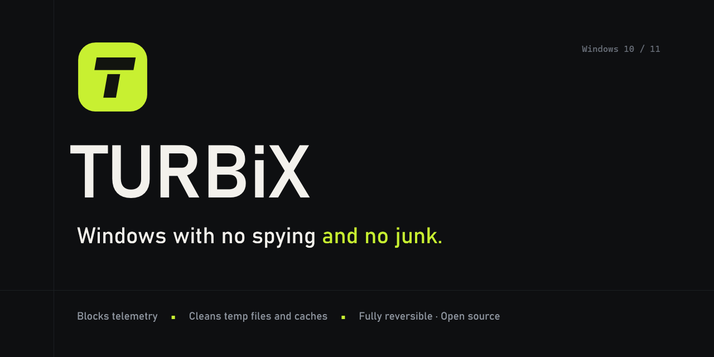
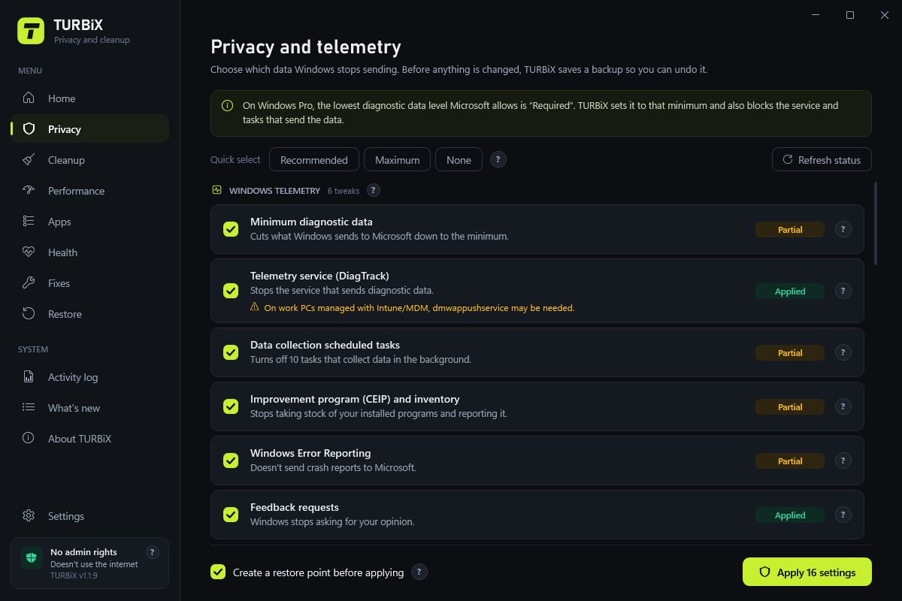
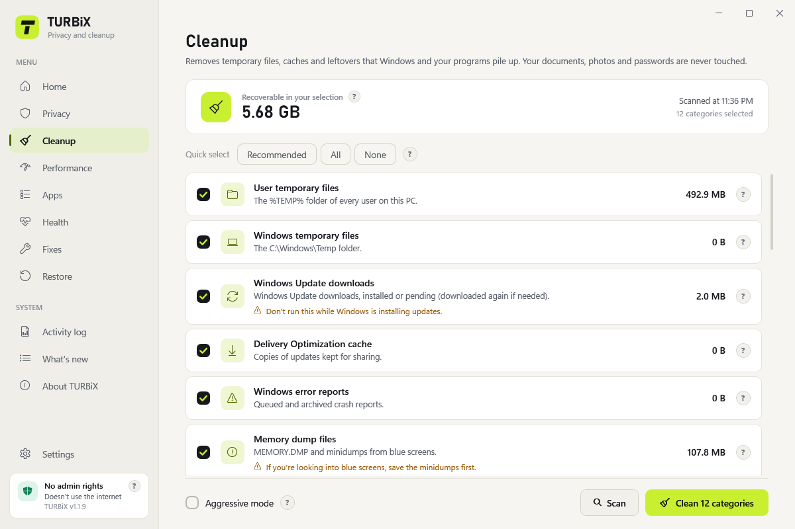
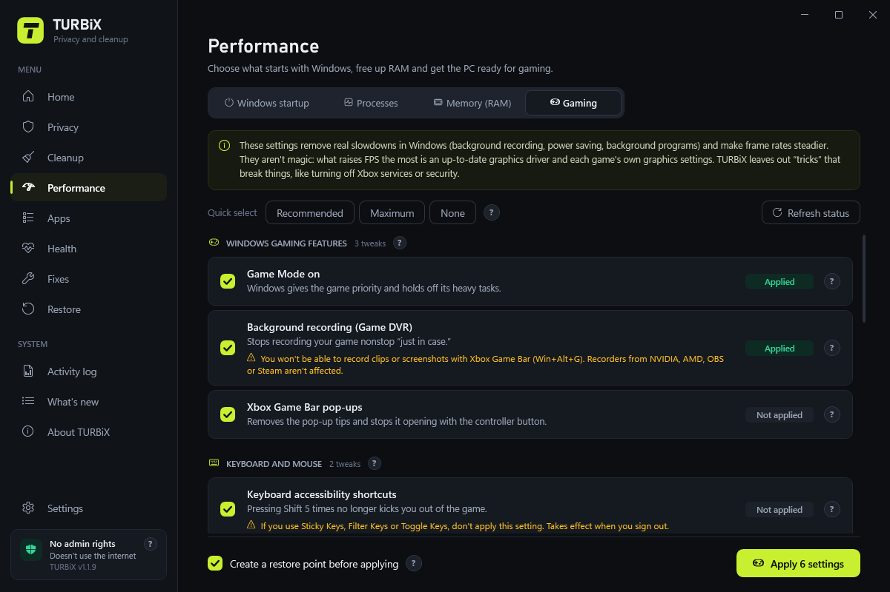
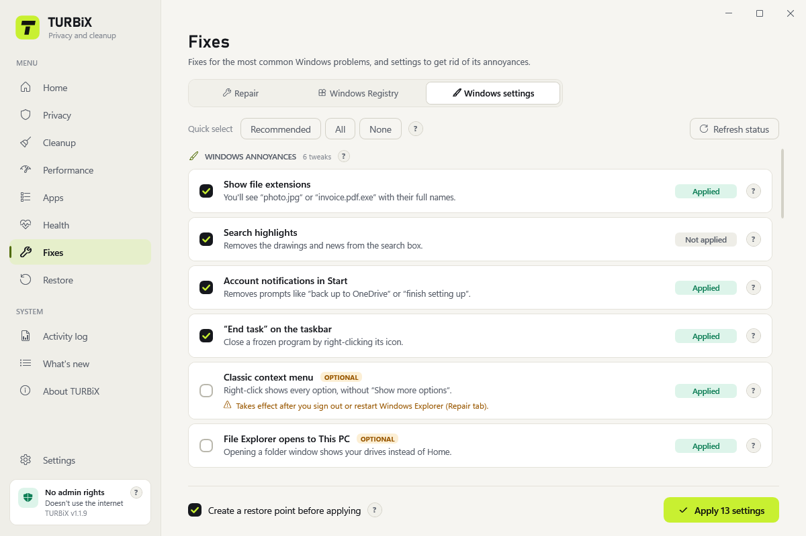

<p align="center">
  
</p>

<p align="center">
  <b>English</b> ·
  <a href="README.es.md">Español</a> ·
  <a href="README.pt-BR.md">Português (Brasil)</a> ·
  <a href="README.fr.md">Français</a> ·
  <a href="README.de.md">Deutsch</a> ·
  <a href="README.ru.md">Русский</a>
</p>

<p align="center"><sub>Free and open source · <a href="#contributing">Contribute</a> · <a href="#donations">Donate</a></sub></p>

# TURBiX

<p align="center">
  <a href="https://github.com/JulianR87/TURBiX/releases/latest"></a>
  <a href="https://github.com/JulianR87/TURBiX/releases"></a>
  <a href="LICENSE"></a>
  
</p>

<p align="center"><b><a href="https://github.com/JulianR87/TURBiX/releases/latest">Download the latest version</a></b></p>

TURBiX is a free, open-source program for **Windows 10 and Windows 11** that does four things:

- **Turns off telemetry** and data collection in Windows and in the most common programs.
- **Improves performance**: it controls what starts with Windows, frees up RAM and gets the PC ready for gaming.
- **Diagnoses and repairs**: it finds out why the PC is slow and runs the usual Windows repairs.
- **Cleans up temporary files, caches and leftovers** that take up space for no reason.

It's a single `TURBiX.exe`. You can use it without installing it (there's also an installer if you prefer one) and there's nothing else to download: it uses .NET Framework 4.6.2, which already comes with Windows 10 (1607 or later) and Windows 11. It works on 32-bit and 64-bit PCs and doesn't use the Internet.

<p align="center">
  
  
</p>
<p align="center">
  
  
</p>

## Contents

- [At a glance](#at-a-glance)
- [What it does](#what-it-does)
- [Settings, the icon next to the clock and running in the background](#settings-the-icon-next-to-the-clock-and-running-in-the-background)
- [Restore, activity log and what's new](#restore-activity-log-and-whats-new)
- [Safety](#safety)
- [Requirements](#requirements)
- [Download and use](#download-and-use)
- [Languages](#languages)
- [Where it keeps its data](#where-it-keeps-its-data)
- [Command-line options](#command-line-options)
- [Frequently asked questions](#frequently-asked-questions)
- [Known limitations](#known-limitations)
- [Building](#building)
- [Brand](#brand)
- [Contributing](#contributing)
- [License](#license)

## At a glance

- **Everything can be undone.** Before it changes anything, TURBiX saves how it was. The **Restore** section puts each session of changes back the way it was.
- **Every option is explained.** Each one has a **?** button that tells you in a few lines what it does and what effect it has.
- **Look first, touch later.** Cleanup, the PC checkup, health and the registry are scanned without changing anything; you decide what to apply.
- **Honest.** It doesn't promise miracles: if the problem is an old drive or too little memory, it says so. It doesn't include “tricks” that break things, either.
- **Doesn't use the Internet.** It downloads nothing, sends no data, and has no accounts or ads.
- **Leaves security alone.** Windows Update, Microsoft Defender, SmartScreen and the firewall stay as they are.
- **Six languages**, light and dark mode, and an icon next to the clock with shortcuts.

## What it does

### Privacy and telemetry

| Group | What it covers |
|---|---|
| Windows telemetry | Diagnostic data level, the DiagTrack and dmwappushservice services, 10 data collection scheduled tasks, CEIP and inventory, error reporting, feedback requests |
| Privacy | Advertising ID, activity history, tailored experiences, inking and typing data, language list for websites, app diagnostics\*, tracking of opened apps\*, online speech recognition\*, location\* |
| Ads and suggestions | Web search in the Start menu, suggested apps, tips and ads in Start, on the lock screen and in File Explorer |
| Artificial intelligence | Copilot and Recall\* |
| Apps | Telemetry from Office, NVIDIA (if installed), developer tools (.NET, PowerShell, VS Code…) and Microsoft Edge\*, plus Delivery Optimization with PCs on the Internet\* |

\* **Advanced** settings: they are only selected with the “Maximum” profile because they can turn off a feature. Their warning is shown in yellow.

### Cleanup

User and Windows temporary files · Windows Update downloads · Delivery Optimization cache · error reports · memory dumps · system logs · internet cache · browser cache (Chrome, Edge, Brave, Vivaldi, Opera, Firefox) · app cache (Discord, Teams, Spotify, Steam, Slack, VS Code) · Microsoft Store cache · DNS cache.

Optional: shader cache · thumbnails · driver installers · Recycle Bin · recent items · Prefetch · event logs · WinSxS cleanup with DISM · previous Windows installation (Windows.old and update leftovers, using Windows Disk Cleanup).

First it **scans** (read-only) and shows how much space each category takes up; then you decide what to clean.

### Performance

- **Windows startup.** Lists the programs that open by themselves when you sign in (registry, Startup folder and Microsoft Store apps) and lets you turn them on or off with a switch. It uses the same mechanism as Task Manager: it doesn't uninstall anything.
- **Processes.** Every running process, as in Task Manager, with processor, memory and threads. The processes each program starts are listed underneath it, every “Service Host” says which service it runs, and you can end a task (the processes Windows needs are locked).
- **Memory (RAM).** Live usage, the programs using the most, a button to free up memory (it trims working sets and empties the standby list) and automatic cleanup every 5, 10, 15, 30 or 60 minutes while TURBiX is open, even if it's only next to the clock. A Windows notification tells you how much memory was freed. Freeing up memory helps when it's nearly full; it doesn't speed up a PC that has plenty to spare.
- **Gaming.** 13 settings: Game Mode, background recording (Game DVR), Game Bar pop-ups, accessibility shortcuts, mouse acceleration\*, multimedia priority, hardware-accelerated GPU scheduling\*, “High performance” power plan\*, power throttling\*, Edge in the background, Store apps in the background\*, widgets\* and visual effects\*.

Left out on purpose are the “tricks” that break things or do nothing: turning off the Xbox services, SysMain or the page file, `bcdedit` changes and anything that weakens security.

### Apps

- **Windows apps.** Removes preinstalled apps from a known list (promoted games and apps, Solitaire, Clipchamp, News, Cortana, Skype…) using the Windows package manager, without PowerShell. It never offers the Store, Xbox, Calculator, “Get Help” or system components. This can't be undone from “Restore”: the apps are reinstalled from Microsoft Store.
- **Installed programs.** The list from Settings › Apps, with size and a search box. “Uninstall” opens each program's official uninstaller.

### Health

The state of each component, based on what it reports to Windows: drives (S.M.A.R.T.: health, wear, temperature, hours of use, errors), battery (capacity compared to new, and cycles), RAM, processor (WHEA hardware errors, temperature if the PC exposes it), graphics card and how old its driver is, devices with driver problems, and blue screens, unexpected shutdowns and disk errors from the last 30 days. Read-only.


### Fixes

- **PC checkup** (on the home screen). Checks the most common causes of a slow PC: a mechanical or failing drive, low free space, low memory, too many startup programs, days without a restart, a pending restart and the power plan. It only reads; each item explains what to do.
- **Repair.** The standard Windows repairs at the press of a button: SFC, DISM RestoreHealth, disk check (`chkdsk /scan`), resetting the network, clearing a stuck print queue and restarting File Explorer.
- **Windows Registry.** Looks for entries that point to files that no longer exist (broken startup entries, ghost programs in the uninstall list, paths and libraries of deleted programs, name cache) and removes them, saving a restorable copy first. It only flags what can be verified; it doesn't touch COM classes or file associations.
- **Windows settings.** Visible file extensions, search highlights, account notifications in Start, “End task” on the taskbar, classic context menu\*, File Explorer opening to “This PC”\*, Storage Sense, Fast startup\*, hibernation\* and SysMain on mechanical drives\* (only offered if Windows is on an HDD). Taskbar and Start: Edge shortcut after updates, the Meet Now, Chat and Cortana buttons, Task View\*, search as an icon\*, taskbar aligned left\*, recent files\* and hidden files\*. Optional services: Fax, retail demo mode, offline maps, Windows Media Player library sharing, Windows Insider\*, Program Compatibility Assistant\*, Print Spooler\* and search indexing\*.


## Settings, the icon next to the clock and running in the background

The **Settings** page brings together everything you can configure about TURBiX itself:

- **Appearance and language.** Light theme, dark theme or the same as Windows. The language follows Windows, but you can pick another one by hand.
- **Open TURBiX when Windows starts.** It waits next to the clock, without opening the window, so the automatic memory cleanup is always running. Because TURBiX needs administrator rights, it uses a Task Scheduler task called “TURBiX”, which is deleted when you turn the option off.
- **Icon next to the clock.** Double-click opens the window. Right-click: open TURBiX, free up RAM, clean temporary files, open Settings or exit. The menu actions report their result with a Windows notification.
- **Keep running when the window is closed.** The X hides the window and TURBiX stays next to the clock. To close it completely, use “Exit TURBiX”, which asks for confirmation (you can turn that off).
- **Automatic memory cleanup.** How often, whether to run only when usage is above 80%, and whether to notify you each time.
- **Data.** Open the data folder and reset every option to its default.

If TURBiX is already open and you open it again, the existing window comes up instead of a second copy. With the window hidden it barely uses the processor: it only checks memory every 30 seconds.

## Restore, activity log and what's new

- **Restore.** Every time you apply settings or repair the registry, a session is created with a copy of what was there before. From here you can undo the whole session with one click. It also opens Windows “System Restore”.
- **Activity log.** Everything TURBiX does is written down, with the time and the result, in one file per day. You can copy it or open the folder.
- **What's new.** The changes in each version, inside the program and in the interface language. It's the same content as [`src/Turbix/Changelog/en.md`](src/Turbix/Changelog/en.md).

## Safety

- TURBiX **never** turns off Windows Update, Microsoft Defender, SmartScreen or the firewall, and never edits the `hosts` file.
- Before a value is changed, the original is saved in `C:\ProgramData\TURBiX\Backups`. From the **Restore** section you can undo each session with one click.
- Optionally, it creates a Windows **restore point** before applying.
- Browsers: only the cache is deleted. Cookies, passwords, history and open sessions are not touched.
- If a program is open, its cache is skipped. Temporary files less than 24 hours old are kept, unless you turn on aggressive mode.
- The cleaner never follows symbolic links or folder junctions.
- Everything is logged in `C:\ProgramData\TURBiX\Logs`.
- TURBiX doesn't connect to the Internet and doesn't send any data.

## Requirements

- Windows 10 version 1607 or later, or Windows 11. 32-bit or 64-bit.
- .NET Framework 4.6.2 or later, which already comes with those versions of Windows. There's nothing to install.
- An account with administrator rights.
- No Internet connection needed. The one exception, which is announced on screen: the `DISM /RestoreHealth` repair can make *Windows* download files from Windows Update.

## Download and use

There are two ways to use it, both from the [Releases](../../releases) section:

- **Installer (`TURBiX-Setup.exe`).** Copies TURBiX to `Program Files`, creates the shortcut in the Start menu (and on the desktop, if you want) and adds it to the Windows list of apps, where it can be uninstalled like any other program.
- **Portable (`TURBiX.exe`).** A single file that runs from any folder, without installing anything.

Either way, Windows will ask for administrator permission, because it's needed to change system settings. After that, start with **Quick optimization** or go through each section.

Uninstalling TURBiX doesn't undo the changes it made to Windows: if you want to go back, use the **Restore** section first. The backups stay in `C:\ProgramData\TURBiX`.

> **SmartScreen warning.** As long as the executable isn't digitally signed, Windows may show “Windows protected your PC”. Select *More info → Run anyway*. If you prefer, build it yourself from the source code.

> **Antivirus.** Some antivirus programs may wrongly flag TURBiX with a generic detection: it's a new, unsigned program that asks for administrator rights and changes Windows settings. TURBiX doesn't connect to the Internet and all of its code is in this repository. If that happens to you, you can check the file on VirusTotal, build it yourself or let us know in [Issues](../../issues) so we can report it to the vendor.

> **Multiple users.** Per-user settings (the advertising ID, for example) are applied to the account that runs TURBiX. On a PC with several accounts, run it from each one.

## Languages

TURBiX automatically shows up in the language Windows uses: **Spanish, English, Portuguese (Brazil), French, German and Russian**. With any other language it's shown in English. You can pick a different one in **Settings**; the change shows up the next time you open TURBiX.

The texts live in plain text files (`src/Turbix/Strings/<area>.<language>.txt`), one per language. The guide for fixing or adding a translation is in [`tools/TRANSLATING.md`](tools/TRANSLATING.md).

## Where it keeps its data

| What | Where |
| --- | --- |
| Backups of every change | `C:\ProgramData\TURBiX\Backups` |
| Activity log (one file per day) | `C:\ProgramData\TURBiX\Logs` |
| Preferences (theme, language, Settings options) | Registry: `HKEY_CURRENT_USER\Software\TURBiX` |
| Starting with Windows | “TURBiX” task in Task Scheduler |
| Installed program (installer only) | `C:\Program Files\TURBiX` |

Only administrators can modify the `ProgramData` folder. TURBiX doesn't store anything else and doesn't write outside these places, apart from the changes you choose to apply.

## Command-line options

| Option | What it does |
| --- | --- |
| `--lang es\|en\|pt\|fr\|de\|ru` | Opens TURBiX in that language, without changing the saved preference. |
| `--startup` | Starts next to the clock, without showing the window. This is what the startup task uses. |
| `--uninstall` | Uninstalls the installed copy. This is what Windows calls from Settings › Apps. |
| `TURBiX-Setup.exe --silent` | Installs without showing any window (for package managers and unattended setups). Add `--no-desktop` to skip the desktop shortcut. |
| `--uninstall --silent` | Uninstalls without asking. |

## Frequently asked questions

**Will TURBiX make my PC fly?**
It depends on what's slowing it down. Removing programs from startup, freeing up space and turning off services you don't use makes a noticeable difference. If the problem is a mechanical drive or too little memory, TURBiX tells you, but that can only be fixed by replacing the part.

**Can I undo what I did?**
Yes, from **Restore**, one whole session at a time. Two things can't be undone from there: files deleted in Cleanup and removed Windows apps, which you reinstall from Microsoft Store. The interface warns you before you confirm.

**Is it safe to clean the registry?**
TURBiX only removes entries that point to files it has verified no longer exist, and it saves a copy first. It doesn't “optimize” or compact the registry, and it says so plainly: cleaning the registry doesn't make the PC faster.

**Why does it ask for administrator rights?**
Because almost everything it does (services, scheduled tasks, system settings, cleaning Windows folders) requires them.

**Do I have to leave it open?**
No. The settings stay applied even if you close TURBiX. It only needs to stay open next to the clock if you want the automatic memory cleanup.

**Does it send any data?**
None. TURBiX has no network code: no statistics, no automatic updates, no accounts.

**How do I update?**
Download the new version. With the installer, install over the old one: it keeps your settings and backups. With the portable version, replace the file.

## Known limitations

- A long task can't be canceled halfway; while it's working, TURBiX won't let itself be closed.
- The whole session is undone, not a single setting.
- If TURBiX is opened with an administrator account other than yours, per-user settings are applied to that account. The PC checkup warns you about it.
- “Windows startup” doesn't list scheduled tasks that run at sign-in.
- Old activity logs and backups aren't deleted automatically.

## Building

You need the [.NET SDK](https://dotnet.microsoft.com/download) (6 or later). The .NET Framework reference assemblies are downloaded automatically.

```cmd
build.cmd
```

You get two files in `dist`: `TURBiX.exe` (portable) and `TURBiX-Setup.exe` (the installer, which carries the same `TURBiX.exe` inside). To build just the program you can also use `dotnet build src\Turbix -c Release`.

The program is C# with WPF on .NET Framework 4.6.2, with no external packages and no PowerShell: a single exe with no dependencies.

### Structure

```
src/Turbix/
  Core/          Registry, services, tasks, backups, memory, processes, health, installer
  Tweaks/        Settings catalogs (privacy, gaming and Windows) and the engine that applies and reverts them
  Cleanup/       Cleanup catalog and the scan and delete engine
  ViewModels/    Interface logic (MVVM)
  Views/         WPF pages, dialogs, icon next to the clock and installer window
  Controls/      “?” help button, progress ring and converters
  Themes/        Light and dark palettes, typography, styles and theme switching
  Localization/  Loading of texts and plurals per language
  Strings/       Interface texts, one file per area and language
  Changelog/     Translated “What's new” (the Spanish one is CHANGELOG.md)
tools/           String checker and translation guide
assets/brand/    Logo and banner
```

To add a setting, edit `Tweaks/TweakCatalog.cs` (privacy), `GamingCatalog.cs` or `WindowsCatalog.cs`. Each setting is a list of registry, service or task actions, and the engine takes care of the backup and the revert. To add a cleanup category, edit `Cleanup/CleanupCatalog.cs`. All visible text goes in `Strings`, in all six languages; `python tools/check_strings.py` checks that none is missing.

## Brand

The logo is a slanted stencil-style “T” on a lime tile (`#C8F031`) with near-black ink (`#12140F`). The heading typeface is Bahnschrift, which comes with Windows. The files are in [`assets/brand`](assets/brand).

## Contributing

TURBiX is a public project, free and with no ads. It doesn't collect data and has no paid version: it's kept going with spare time and with the help of the people who use it. Every contribution counts, and you don't need to know how to code:

- **Report a bug or suggest an improvement** in [Issues](../../issues). The more detail (Windows version, what you did, what you expected), the easier it is to fix.
- **Improve a translation.** The texts are in `src/Turbix/Strings` and the guide is in [`tools/TRANSLATING.md`](tools/TRANSLATING.md).
- **Send code** with a *pull request*: a new setting, a cleanup category or a fix.
- **Tell someone** who could use it. It's the best way for the project to grow.

### Donations

If TURBiX saved you time or gave you back a PC that was running slow, you can support its development with a donation. It's entirely voluntary: the program is free and will stay free, with or without it.

| Coin | Network | Address |
| --- | --- | --- |
| **Bitcoin (BTC)** | Bitcoin | `bc1q527vjd3vcj6vwg6dg8g0dengh6hd9944l73jqe` |
| **Ethereum (ETH)** | BEP20 (BNB Smart Chain) | `0xC1162610b1A6b8532f4233Db598F624D8EF4d2C4` |
| **Tether (USDT)** | BEP20 (BNB Smart Chain) | `0xC1162610b1A6b8532f4233Db598F624D8EF4d2C4` |

> **Important: check the network before you send.** BTC only over the Bitcoin network; ETH and USDT only over the BEP20 network. Anything sent over another network is lost and can't be recovered.

Thank you for helping TURBiX stay free.

## License

[MIT](LICENSE). Microsoft, Windows, Edge, Office and Copilot are trademarks of Microsoft Corporation. TURBiX is not affiliated with Microsoft.
