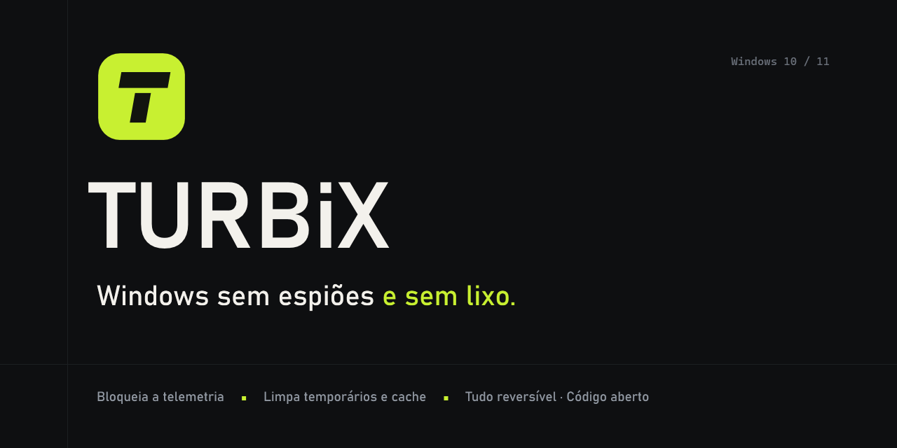

<p align="center">
  
</p>

<p align="center">
  <a href="README.md">English</a> ·
  <a href="README.es.md">Español</a> ·
  <b>Português (Brasil)</b> ·
  <a href="README.fr.md">Français</a> ·
  <a href="README.de.md">Deutsch</a> ·
  <a href="README.ru.md">Русский</a>
</p>

<p align="center"><sub>Livre e de código aberto · <a href="#colaborar">Colaborar</a> · <a href="#doações">Doar</a></sub></p>

# TURBiX

O TURBiX é um programa gratuito e de código aberto para **Windows 10 e Windows 11** que faz quatro coisas:

- **Desativa a telemetria** e a coleta de dados do Windows e dos programas mais comuns.
- **Melhora o desempenho**: controla o que inicia com o Windows, libera memória RAM e deixa o PC pronto para jogar.
- **Diagnostica e repara**: descobre por que o computador está lento e aplica os reparos de praxe do Windows.
- **Limpa arquivos temporários, caches e restos** que ocupam espaço à toa.

É um único `TURBiX.exe`. Dá para usar sem instalar (também há um instalador para quem preferir) e não é preciso baixar mais nada: ele usa o .NET Framework 4.6.2, que já vem no Windows 10 (1607 ou posterior) e no Windows 11. Funciona em computadores de 32 e 64 bits e não usa a Internet.

## Sumário

- [Em resumo](#em-resumo)
- [O que ele faz](#o-que-ele-faz)
- [Ajustes, ícone ao lado do relógio e segundo plano](#ajustes-ícone-ao-lado-do-relógio-e-segundo-plano)
- [Restaurar, registro de atividades e novidades](#restaurar-registro-de-atividades-e-novidades)
- [Segurança](#segurança)
- [Requisitos](#requisitos)
- [Download e uso](#download-e-uso)
- [Idiomas](#idiomas)
- [Onde ele guarda os dados](#onde-ele-guarda-os-dados)
- [Opções de linha de comando](#opções-de-linha-de-comando)
- [Perguntas frequentes](#perguntas-frequentes)
- [Limitações conhecidas](#limitações-conhecidas)
- [Compilar](#compilar)
- [Marca](#marca)
- [Colaborar](#colaborar)
- [Licença](#licença)

## Em resumo

- **Tudo pode ser desfeito.** Antes de mudar qualquer coisa, o TURBiX guarda como estava. A seção **Restaurar** devolve cada sessão de mudanças ao estado anterior.
- **Cada opção é explicada.** Todas têm um botão **?** que conta em poucas linhas o que ela faz e qual é o efeito.
- **Primeiro olha, depois mexe.** A limpeza, o diagnóstico, a saúde e o Registro são analisados sem alterar nada; você decide o que aplicar.
- **Honesto.** Não promete milagre: se o problema é um disco velho ou pouca memória, ele avisa. Também não traz “truques” que quebram coisas.
- **Não usa a Internet.** Não baixa nada, não envia dados, não tem contas nem propaganda.
- **Não mexe na segurança.** O Windows Update, o Microsoft Defender, o SmartScreen e o firewall ficam como estão.
- **Seis idiomas**, modo claro e escuro, e um ícone ao lado do relógio com atalhos.

## O que ele faz

### Privacidade e telemetria

| Grupo | O que cobre |
|---|---|
| Telemetria do Windows | Nível dos dados de diagnóstico, serviços DiagTrack e dmwappushservice, 10 tarefas agendadas de coleta, CEIP e inventário, relatório de erros, pedidos de comentários |
| Privacidade | ID de publicidade, histórico de atividades, experiências personalizadas, dados de escrita à tinta e digitação, lista de idiomas para sites, diagnóstico de aplicativos\*, rastreamento de aplicativos abertos\*, reconhecimento de fala online\*, localização\* |
| Anúncios e sugestões | Pesquisa na Web no menu Iniciar, aplicativos sugeridos, dicas e anúncios no Iniciar, na tela de bloqueio e no Explorador |
| Inteligência artificial | Copilot e Recall\* |
| Aplicativos | Telemetria do Office, da NVIDIA (se estiver instalada), de ferramentas de desenvolvimento (.NET, PowerShell, VS Code…), do Microsoft Edge\* e Otimização de Entrega com computadores da Internet\* |

\* Ajustes **avançados**: só são marcados com o perfil “Máximo”, porque podem desativar algum recurso. O aviso deles aparece em amarelo.

### Limpeza

Temporários do usuário e do Windows · downloads do Windows Update · cache da Otimização de Entrega · relatórios de erros · despejos de memória · arquivos de log do sistema · cache de Internet · cache dos navegadores (Chrome, Edge, Brave, Vivaldi, Opera, Firefox) · cache de aplicativos (Discord, Teams, Spotify, Steam, Slack, VS Code) · cache da Microsoft Store · cache DNS.

Opcionais: cache de shaders · miniaturas · instaladores de drivers · Lixeira · itens recentes · Prefetch · logs de eventos · limpeza do WinSxS com o DISM · instalação anterior do Windows (Windows.old e restos de atualizações, com a Limpeza de Disco do Windows).

Primeiro ele **analisa** (somente leitura) e mostra quanto cada categoria ocupa; depois você decide o que limpar.

### Desempenho

- **Inicialização do Windows.** Lista os programas que abrem sozinhos quando você entra no Windows (Registro, pasta Inicializar e aplicativos da Microsoft Store) e permite ativar ou desativar cada um com um botão. Usa o mesmo mecanismo do Gerenciador de Tarefas: não desinstala nada.
- **Processos.** Todos os processos abertos, como no Gerenciador de Tarefas, com processador, memória e threads. Os processos que cada programa abre aparecem embaixo dele, cada “Host de Serviço” diz qual serviço executa e dá para finalizar uma tarefa (os processos de que o Windows precisa ficam bloqueados).
- **Memória RAM.** Uso em tempo real, programas que mais ocupam, botão para liberar memória (reduz os conjuntos de trabalho e esvazia a lista em espera) e liberação automática a cada 5, 10, 15, 30 ou 60 minutos enquanto o TURBiX estiver aberto, mesmo que só ao lado do relógio. Ele avisa com uma notificação do Windows quanta memória liberou. Liberar memória ajuda quando ela está quase cheia; não acelera um computador que tem memória de sobra.
- **Jogos.** 13 ajustes: Modo de Jogo, gravação em segundo plano (Game DVR), avisos da Xbox Game Bar, atalhos de acessibilidade, aceleração do mouse\*, prioridade multimídia, agendamento de GPU acelerado por hardware\*, plano “Alto desempenho”\*, limitação de energia\*, Edge em segundo plano, apps da Store em segundo plano\*, widgets\* e efeitos visuais\*.

Ficam de fora, de propósito, os “truques” que quebram coisas ou não servem para nada: desligar os serviços do Xbox, o SysMain ou o arquivo de paginação, mudanças com `bcdedit` e qualquer coisa que enfraqueça a segurança.

### Aplicativos

- **Aplicativos do Windows.** Remove os aplicativos pré-instalados de uma lista conhecida (jogos e aplicativos de propaganda, Paciência, Clipchamp, Notícias, Cortana, Skype…) com o gerenciador de pacotes do Windows, sem PowerShell. Nunca oferece a Loja, o Xbox, a Calculadora, o “Obter Ajuda” nem componentes do sistema. Isso não é desfeito em “Restaurar”: os aplicativos são reinstalados pela Microsoft Store.
- **Programas instalados.** A lista de Configurações › Aplicativos, com tamanho e busca. “Desinstalar” abre o desinstalador oficial de cada programa.

### Saúde

Estado de cada componente, de acordo com o que ele informa ao Windows: discos (S.M.A.R.T.: saúde, desgaste, temperatura, horas de uso, erros), bateria (capacidade em relação a uma nova e ciclos), memória RAM, processador (erros de hardware WHEA, temperatura se o computador a informar), placa de vídeo e idade do driver, dispositivos com problema de driver, e telas azuis, desligamentos inesperados e erros de disco dos últimos 30 dias. Somente leitura.


### Soluções

- **Diagnóstico** (na tela inicial). Verifica as causas mais comuns de um PC lento: disco mecânico ou com falhas, pouco espaço, pouca memória, programas demais na inicialização, dias sem reiniciar, reinicialização pendente e plano de energia. Só lê; cada ponto explica o que fazer.
- **Reparar.** Os reparos padrão do Windows em um clique: SFC, DISM RestoreHealth, verificação de disco (`chkdsk /scan`), redefinir a rede, destravar a fila de impressão e reiniciar o Windows Explorer.
- **Registro do Windows.** Procura entradas que apontam para arquivos que não existem mais (inicializações quebradas, programas fantasmas na lista de desinstalação, caminhos e bibliotecas de programas apagados, cache de nomes) e as remove, guardando antes uma cópia que pode ser restaurada. Só marca o que dá para comprovar; não mexe em classes COM nem em associações de arquivos.
- **Ajustes do Windows.** Extensões de arquivo visíveis, destaques da pesquisa, avisos da conta no menu Iniciar, “Finalizar tarefa” na barra de tarefas, menu de contexto clássico\*, Explorador em “Este Computador”\*, Sensor de Armazenamento, Inicialização Rápida\*, hibernação\* e SysMain em discos mecânicos\* (só é oferecido se o Windows estiver em um HD). Barra de tarefas e Iniciar: atalho do Edge depois de atualizar, botões Reunir agora, Chat e Cortana, Visão de Tarefas\*, pesquisa como ícone\*, barra à esquerda\*, arquivos recentes\* e arquivos ocultos\*. Serviços opcionais: Fax, modo de demonstração para lojas, mapas offline, compartilhamento do Windows Media Player, Windows Insider\*, Assistente de Compatibilidade de Programas\*, Spooler de Impressão\* e indexação de pesquisa\*.


## Ajustes, ícone ao lado do relógio e segundo plano

A página **Ajustes** reúne tudo o que dá para configurar no próprio TURBiX:

- **Aparência e idioma.** Tema claro, escuro ou igual ao do Windows. O idioma segue o do Windows, mas você pode escolher outro.
- **Abrir o TURBiX ao iniciar o Windows.** Ele fica ao lado do relógio, sem abrir a janela, para que a liberação automática de memória esteja sempre ativa. Como o TURBiX precisa de permissões de administrador, ele usa uma tarefa do Agendador de Tarefas chamada “TURBiX”, que é apagada quando você desativa a opção.
- **Ícone ao lado do relógio.** Fica na área de notificação; dois cliques abrem a janela. Com o botão direito: abrir o TURBiX, liberar memória RAM, limpar arquivos temporários, abrir os Ajustes ou sair. As ações do menu avisam o resultado com uma notificação do Windows.
- **Continuar funcionando ao fechar a janela.** O X esconde a janela e o TURBiX fica ao lado do relógio. Para fechá-lo de vez, use “Sair do TURBiX”, que pede confirmação (dá para desativar).
- **Liberação automática de memória.** De quanto em quanto tempo, só se o uso passar de 80 % e se ele avisa a cada vez.
- **Dados.** Abrir a pasta de dados e voltar todas as opções ao padrão.

Se o TURBiX já estiver aberto e você abri-lo de novo, aparece a janela que já existia em vez de uma segunda cópia. Com a janela escondida ele quase não usa o processador: só verifica a memória a cada 30 segundos.

## Restaurar, registro de atividades e novidades

- **Restaurar.** Sempre que você aplica ajustes ou repara o Registro, é criada uma sessão com a cópia do que havia. Daqui você reverte a sessão inteira com um clique. Também abre a “Restauração do Sistema” do Windows.
- **Registro de atividades.** Tudo o que o TURBiX faz fica anotado, com hora e resultado, em um arquivo por dia. Dá para copiar ou abrir a pasta.
- **Novidades.** As mudanças de cada versão, dentro do programa e no idioma da interface. É o mesmo conteúdo do [`src/Turbix/Changelog/pt.md`](src/Turbix/Changelog/pt.md).

## Segurança

- **Nunca** são desativados o Windows Update, o Microsoft Defender, o SmartScreen nem o firewall, e o arquivo `hosts` não é alterado.
- Antes de mudar um valor, o original é guardado em `C:\ProgramData\TURBiX\Backups`. Na seção **Restaurar** você pode reverter cada sessão com um clique.
- Opcionalmente, ele cria um **ponto de restauração** do Windows antes de aplicar.
- Navegadores: só o cache é apagado. Cookies, senhas, histórico e sessões abertas não são tocados.
- Se um programa estiver aberto, o cache dele é pulado. Os temporários com menos de 24 horas são mantidos, a não ser que você ative o modo agressivo.
- A limpeza nunca segue links simbólicos nem junções de pastas.
- Tudo fica anotado em `C:\ProgramData\TURBiX\Logs`.
- O TURBiX não se conecta à Internet nem envia dado nenhum.

## Requisitos

- Windows 10 versão 1607 ou posterior, ou Windows 11. 32 ou 64 bits.
- .NET Framework 4.6.2 ou posterior, que já vem com essas versões do Windows. Não é preciso instalar nada.
- Uma conta com permissões de administrador.
- Não precisa de conexão com a Internet. Única exceção, avisada na tela: o reparo `DISM /RestoreHealth` pode fazer o *Windows* baixar arquivos do Windows Update.

## Download e uso

Há duas formas de usar, as duas na seção [Releases](../../releases):

- **Instalador (`TURBiX-Setup.exe`).** Copia o TURBiX para `Arquivos de Programas`, cria o atalho no menu Iniciar (e na área de trabalho, se você quiser) e o adiciona à lista de aplicativos do Windows, por onde ele é desinstalado como qualquer outro programa.
- **Portátil (`TURBiX.exe`).** Um único arquivo que roda em qualquer pasta, sem instalar nada.

Nos dois casos, o Windows vai pedir permissões de administrador, porque elas são necessárias para mudar as configurações do sistema. Depois, comece pela **Otimização rápida** ou veja cada seção.

Desinstalar o TURBiX não desfaz as mudanças que ele aplicou no Windows: se quiser voltar atrás, use antes a seção **Restaurar**. As cópias de segurança ficam em `C:\ProgramData\TURBiX`.

> **Aviso do SmartScreen.** Enquanto o executável não tiver assinatura digital, o Windows pode mostrar “O Windows protegeu o computador”. Clique em *Mais informações → Executar assim mesmo*. Se preferir, compile você mesmo a partir do código.

> **Antivírus.** Algum antivírus pode marcar o TURBiX por engano com uma detecção genérica: é um programa novo, sem assinatura, que pede permissões de administrador e muda as configurações do Windows. O TURBiX não se conecta à Internet e todo o código dele está neste repositório. Se acontecer com você, dá para verificar o arquivo no VirusTotal, compilar você mesmo ou avisar em [Issues](../../issues) para reportarmos ao fabricante.

> **Vários usuários.** Os ajustes por usuário (por exemplo, o ID de publicidade) são aplicados à conta que executa o TURBiX. Em um computador com várias contas, execute-o em cada uma.

## Idiomas

O TURBiX aparece sozinho no idioma do Windows: **espanhol, inglês, português (Brasil), francês, alemão e russo**. Com qualquer outro idioma, ele aparece em inglês. Em **Ajustes** dá para escolher outro; a mudança aparece quando você abre o TURBiX de novo.

Os textos ficam em arquivos de texto simples (`src/Turbix/Strings/<área>.<idioma>.txt`), um por idioma. O guia para corrigir ou adicionar uma tradução está em [`tools/TRANSLATING.pt-BR.md`](tools/TRANSLATING.pt-BR.md).

## Onde ele guarda os dados

| O quê | Onde |
| --- | --- |
| Cópias de segurança de cada mudança | `C:\ProgramData\TURBiX\Backups` |
| Registro de atividades (um arquivo por dia) | `C:\ProgramData\TURBiX\Logs` |
| Preferências (tema, idioma, opções dos Ajustes) | Registro: `HKEY_CURRENT_USER\Software\TURBiX` |
| Inicialização com o Windows | Tarefa “TURBiX” do Agendador de Tarefas |
| Programa instalado (só com o instalador) | `C:\Program Files\TURBiX` |

A pasta em `ProgramData` só pode ser alterada por administradores. O TURBiX não guarda mais nada e não grava fora desses lugares, além das mudanças que você decide aplicar.

## Opções de linha de comando

| Opção | O que faz |
| --- | --- |
| `--lang es\|en\|pt\|fr\|de\|ru` | Abre o TURBiX nesse idioma, sem mudar a preferência salva. |
| `--startup` | Inicia ao lado do relógio, sem mostrar a janela. É o que a tarefa de inicialização usa. |
| `--uninstall` | Desinstala a cópia instalada. É o que o Windows chama em Configurações › Aplicativos. |

## Perguntas frequentes

**O TURBiX vai fazer meu PC voar?**
Depende do que está deixando ele lento. Tirar programas da inicialização, liberar espaço e desligar serviços que você não usa faz diferença. Se o problema for um disco mecânico ou pouca memória, o TURBiX avisa, mas isso só se resolve trocando a peça.

**Posso desfazer o que fiz?**
Sim, em **Restaurar**, a sessão inteira de cada vez. Duas coisas não são revertidas por lá: os arquivos apagados na Limpeza e os aplicativos do Windows removidos, que são reinstalados pela Microsoft Store. A interface avisa antes de você confirmar.

**É seguro limpar o Registro?**
O TURBiX só remove entradas que apontam para arquivos que ele comprovou que não existem mais, e guarda uma cópia antes. Ele não “otimiza” nem compacta o Registro, e diz isso com todas as letras: limpar o Registro não acelera o computador.

**Por que ele pede permissões de administrador?**
Porque quase tudo o que ele faz (serviços, tarefas agendadas, configurações do sistema, limpeza de pastas do Windows) exige isso.

**Preciso deixá-lo aberto?**
Não. Os ajustes continuam aplicados mesmo que você feche o TURBiX. Ele só precisa ficar aberto ao lado do relógio se você quiser a liberação automática de memória.

**Ele envia algum dado?**
Nenhum. O TURBiX não tem código de rede: nem estatísticas, nem atualizações automáticas, nem contas.

**Como eu atualizo?**
Baixe a versão nova. Com o instalador, instale por cima: ele mantém os ajustes e as cópias de segurança. Com a portátil, substitua o arquivo.

## Limitações conhecidas

- Uma tarefa longa não pode ser cancelada no meio; enquanto trabalha, o TURBiX não deixa que você o feche.
- A reversão é da sessão inteira, não de um ajuste isolado.
- Se o TURBiX for aberto com uma conta de administrador diferente da sua, os ajustes por usuário são aplicados a essa conta. O diagnóstico avisa.
- A aba “Inicialização” não lista as tarefas agendadas que rodam quando você entra no Windows.
- Os registros de atividades e as cópias antigas não são apagados sozinhos.

## Compilar

Você precisa do [SDK do .NET](https://dotnet.microsoft.com/download) (6 ou posterior). Os assemblies de referência do .NET Framework são baixados automaticamente.

```cmd
build.cmd
```

Ficam dois arquivos em `dist`: `TURBiX.exe` (portátil) e `TURBiX-Setup.exe` (instalador, que leva dentro o mesmo `TURBiX.exe`). Para compilar só o programa, você também pode usar `dotnet build src\Turbix -c Release`.

O programa é C# com WPF sobre o .NET Framework 4.6.2, sem pacotes externos e sem PowerShell: um único exe sem dependências.

### Estrutura

```
src/Turbix/
  Core/          Registro, serviços, tarefas, cópias, memória, processos, saúde, instalador
  Tweaks/        Catálogos de ajustes (privacidade, jogos e Windows) e motor que os aplica e reverte
  Cleanup/       Catálogo de limpeza e motor de análise e exclusão
  ViewModels/    Lógica da interface (MVVM)
  Views/         Páginas WPF, diálogos, ícone ao lado do relógio e janela do instalador
  Controls/      Botão de ajuda “?”, anel de progresso e conversores
  Themes/        Paletas clara e escura, tipografia, estilos e troca de tema
  Localization/  Carregamento de textos e plurais por idioma
  Strings/       Textos da interface, um arquivo por área e idioma
  Changelog/     “Novidades” traduzido (o espanhol é o CHANGELOG.md)
tools/           Verificador de textos e guia de tradução
assets/brand/    Logotipo e banner
```

Para adicionar um ajuste, edite `Tweaks/TweakCatalog.cs` (privacidade), `GamingCatalog.cs` ou `WindowsCatalog.cs`. Cada ajuste é uma lista de ações de Registro, serviço ou tarefa, e o motor cuida da cópia e da reversão. Para adicionar uma categoria de limpeza, edite `Cleanup/CleanupCatalog.cs`. Todo texto visível fica em `Strings`, nos seis idiomas; `python tools/check_strings.py` verifica se não falta nenhum.

## Marca

O logotipo é um “T” em estilo estêncil, inclinado, sobre um quadrado verde-limão (`#C8F031`) com tinta quase preta (`#12140F`). A fonte dos títulos é a Bahnschrift, que já vem no Windows. Os arquivos estão em [`assets/brand`](assets/brand).

## Colaborar

O TURBiX é um projeto público, gratuito e sem propaganda. Não coleta dados nem tem versão paga: é mantido no tempo livre e com a ajuda de quem usa. Toda colaboração conta, e não precisa saber programar:

- **Avise de um erro ou sugira uma melhoria** em [Issues](../../issues). Quanto mais detalhes (versão do Windows, o que você fez, o que esperava), mais fácil fica corrigir.
- **Melhore uma tradução.** Os textos ficam em `src/Turbix/Strings` e o guia em [`tools/TRANSLATING.pt-BR.md`](tools/TRANSLATING.pt-BR.md).
- **Envie código** com um *pull request*: um ajuste novo, uma categoria de limpeza ou uma correção.
- **Conte para alguém** que possa aproveitar. É a melhor forma de o projeto crescer.

### Doações

Se o TURBiX poupou seu tempo ou recuperou um computador que andava lento, você pode apoiar o desenvolvimento com uma doação. É totalmente voluntária: o programa é e vai continuar sendo gratuito, com ou sem ela.

| Moeda | Rede | Endereço |
| --- | --- | --- |
| **Bitcoin (BTC)** | Bitcoin | `bc1q527vjd3vcj6vwg6dg8g0dengh6hd9944l73jqe` |
| **Ethereum (ETH)** | BEP20 (BNB Smart Chain) | `0xC1162610b1A6b8532f4233Db598F624D8EF4d2C4` |
| **Tether (USDT)** | BEP20 (BNB Smart Chain) | `0xC1162610b1A6b8532f4233Db598F624D8EF4d2C4` |

> **Importante: confira a rede antes de enviar.** BTC só pela rede Bitcoin; ETH e USDT só pela rede BEP20. Um envio por outra rede se perde e não pode ser recuperado.

Obrigado por ajudar o TURBiX a continuar livre.

## Licença

[MIT](LICENSE). Microsoft, Windows, Edge, Office e Copilot são marcas da Microsoft Corporation. O TURBiX não é afiliado à Microsoft.
