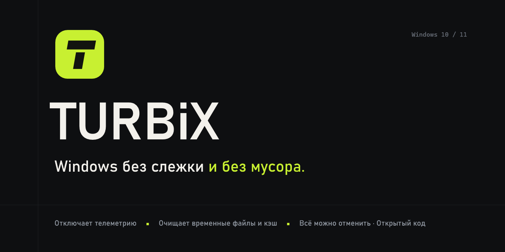
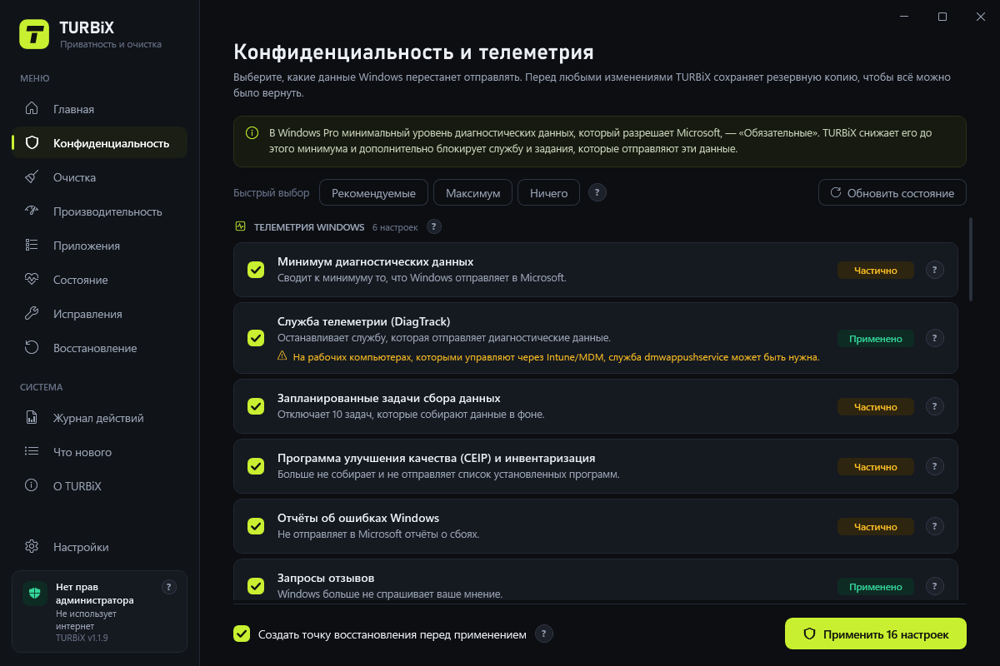
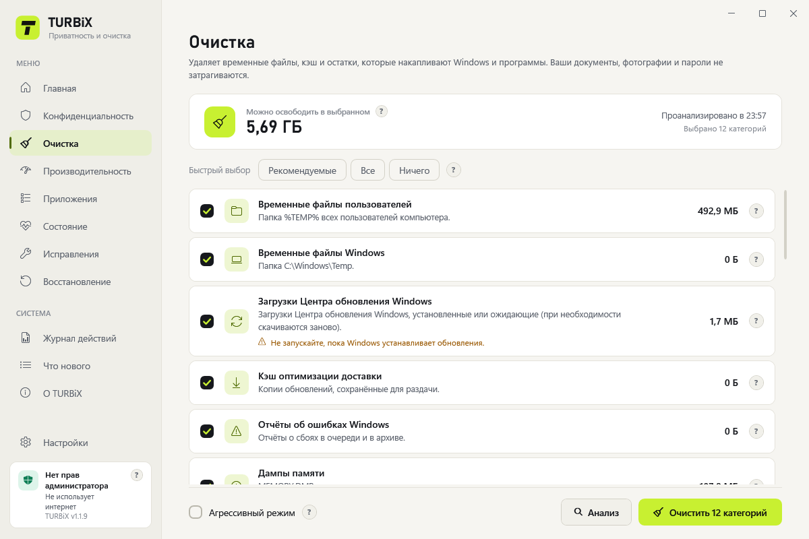
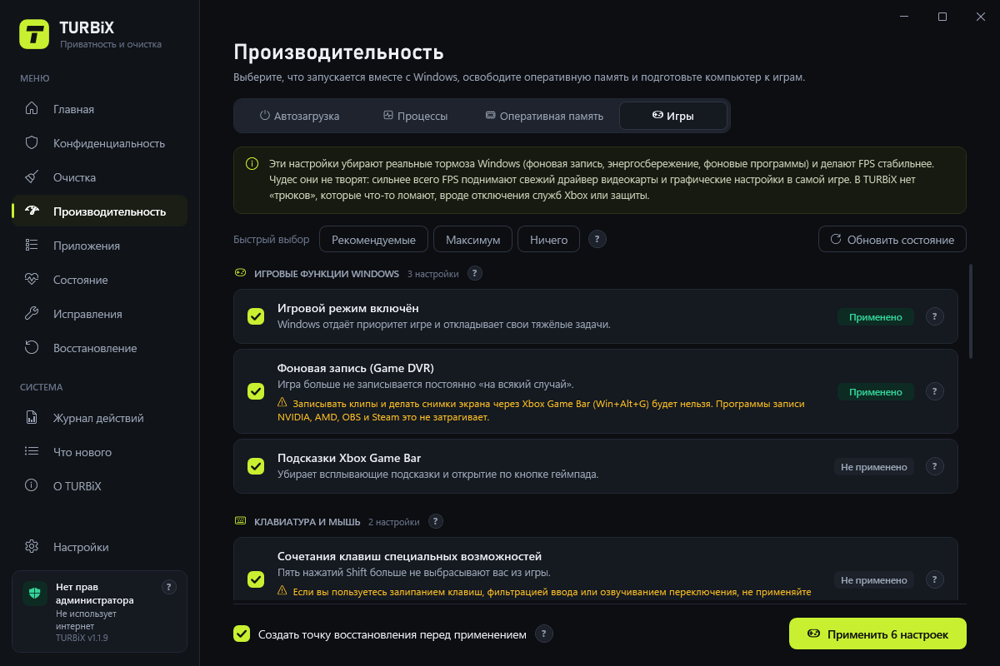
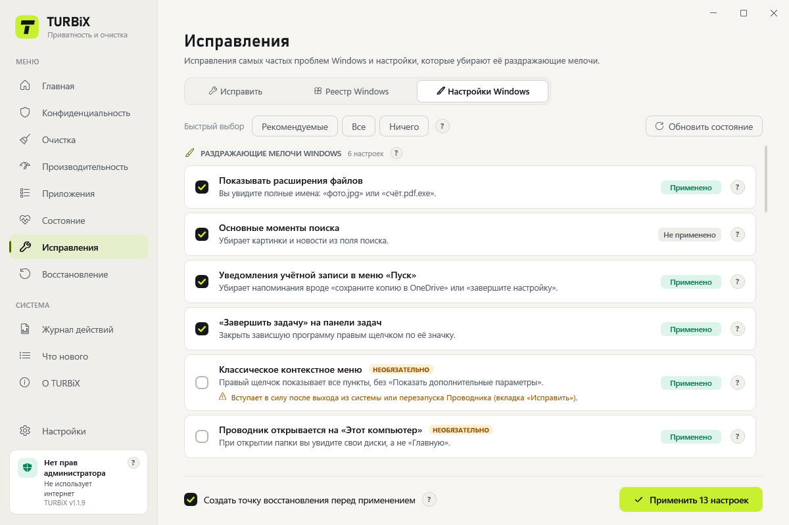

<p align="center">
  
</p>

<p align="center">
  <a href="README.md">English</a> ·
  <a href="README.es.md">Español</a> ·
  <a href="README.pt-BR.md">Português (Brasil)</a> ·
  <a href="README.fr.md">Français</a> ·
  <a href="README.de.md">Deutsch</a> ·
  <b>Русский</b>
</p>

<p align="center"><sub>Свободная программа с открытым кодом · <a href="#как-помочь">Помочь проекту</a> · <a href="#пожертвования">Пожертвовать</a></sub></p>

# TURBiX

<p align="center">
  <a href="https://github.com/JulianR87/TURBiX/releases/latest"></a>
  <a href="https://github.com/JulianR87/TURBiX/releases"></a>
  <a href="LICENSE"></a>
  
</p>

<p align="center"><b><a href="https://github.com/JulianR87/TURBiX/releases/latest">Скачать последнюю версию</a></b></p>

TURBiX — бесплатная программа с открытым исходным кодом для **Windows 10 и Windows 11**. Она делает четыре вещи:

- **Отключает телеметрию** и сбор данных в Windows и в самых распространённых программах.
- **Повышает производительность**: позволяет выбрать, что запускается вместе с Windows, освобождает оперативную память и готовит компьютер к играм.
- **Диагностирует и исправляет**: находит, почему компьютер работает медленно, и запускает стандартные средства восстановления Windows.
- **Удаляет временные файлы, кэш и остатки**, которые зря занимают место.

Это один файл `TURBiX.exe`. Им можно пользоваться без установки (для тех, кому так удобнее, есть и установщик), и больше ничего скачивать не нужно: программа работает на .NET Framework 4.6.2, который уже входит в Windows 10 (1607 и новее) и Windows 11. TURBiX работает на 32- и 64-разрядных системах и не использует Интернет.

<p align="center">
  
  
</p>
<p align="center">
  
  
</p>

## Содержание

- [Коротко](#коротко)
- [Что умеет](#что-умеет)
- [Настройки, значок рядом с часами и работа в фоне](#настройки-значок-рядом-с-часами-и-работа-в-фоне)
- [Восстановление, журнал действий и «Что нового»](#восстановление-журнал-действий-и-что-нового)
- [Безопасность](#безопасность)
- [Требования](#требования)
- [Загрузка и использование](#загрузка-и-использование)
- [Языки](#языки)
- [Где хранятся данные](#где-хранятся-данные)
- [Параметры командной строки](#параметры-командной-строки)
- [Частые вопросы](#частые-вопросы)
- [Известные ограничения](#известные-ограничения)
- [Сборка](#сборка)
- [Фирменный стиль](#фирменный-стиль)
- [Как помочь](#как-помочь)
- [Лицензия](#лицензия)

## Коротко

- **Всё можно отменить.** Прежде чем что-то изменить, TURBiX сохраняет, как было. Раздел **Восстановление** возвращает каждый сеанс изменений в прежнее состояние.
- **Каждая опция объяснена.** У каждой есть кнопка **?**, которая в нескольких строках рассказывает, что она делает и на что влияет.
- **Сначала смотрит, потом трогает.** Очистка, диагностика, состояние и реестр сначала анализируются без каких-либо изменений; что применять, решаете вы.
- **Честно.** Чудес не обещает: если дело в старом диске или нехватке памяти, так и скажет. И никаких «трюков», которые что-нибудь ломают.
- **Не использует Интернет.** Ничего не скачивает, не отправляет данные, в нём нет учётных записей и рекламы.
- **Не трогает безопасность.** Центр обновления Windows, Microsoft Defender, SmartScreen и брандмауэр остаются как есть.
- **Шесть языков**, светлая и тёмная темы и значок рядом с часами с быстрыми действиями.

## Что умеет

### Конфиденциальность и телеметрия

| Группа | Что входит |
|---|---|
| Телеметрия Windows | Уровень диагностических данных, службы DiagTrack и dmwappushservice, 10 запланированных задач сбора данных, CEIP и инвентаризация, отчёты об ошибках, запросы отзывов |
| Конфиденциальность | Рекламный идентификатор, журнал действий, индивидуальные возможности, данные рукописного ввода и набора текста, список языков для сайтов, диагностика приложений\*, отслеживание запуска приложений\*, распознавание голоса в сети\*, местоположение\* |
| Реклама и рекомендации | Веб-поиск в меню «Пуск», рекомендуемые приложения, советы и реклама в меню «Пуск», на экране блокировки и в Проводнике |
| Искусственный интеллект | Copilot и Recall\* |
| Приложения | Телеметрия Office, NVIDIA (если установлено), средств разработки (.NET, PowerShell, VS Code…), Microsoft Edge\* и оптимизация доставки между компьютерами в Интернете\* |

\* Настройки **для опытных**: отмечаются только в профиле «Максимум», потому что могут отключить какую-нибудь функцию. Предупреждение к ним выделено жёлтым.

### Очистка

Временные файлы пользователей и Windows · загрузки Центра обновления Windows · кэш оптимизации доставки · отчёты об ошибках · дампы памяти · журналы системы · интернет-кэш · кэш браузеров (Chrome, Edge, Brave, Vivaldi, Opera, Firefox) · кэш приложений (Discord, Teams, Spotify, Steam, Slack, VS Code) · кэш Microsoft Store · кэш DNS.

Необязательно: кэш шейдеров · эскизы · установщики драйверов · корзина · недавние элементы · Prefetch · журналы событий · очистка WinSxS через DISM · предыдущая установка Windows (Windows.old и остатки обновлений, с помощью «Очистки диска» Windows).

Сначала выполняется **анализ** (только чтение), и вы видите, сколько занимает каждая категория; потом решаете, что удалять.

### Производительность

- **Автозагрузка.** Показывает программы, которые сами открываются при входе в систему (реестр, папка «Автозагрузка» и приложения из Microsoft Store), и позволяет включать и отключать их переключателем. Механизм тот же, что в Диспетчере задач: ничего не удаляется.
- **Процессы.** Все запущенные процессы, как в Диспетчере задач: процессор, память и потоки. Процессы, запущенные программой, раскрываются под ней, у каждого «Узла службы» указано, какую службу он выполняет, и задачу можно снять (процессы, нужные Windows, заблокированы).
- **Оперативная память.** Использование в реальном времени, самые «тяжёлые» программы, кнопка освобождения памяти (сокращает рабочие наборы и очищает список ожидания) и автоматическая очистка каждые 5, 10, 15, 30 или 60 минут, пока TURBiX открыт, пусть даже только рядом с часами. Уведомление Windows сообщает, сколько памяти освобождено. Освобождать память полезно, когда она почти заполнена; компьютер, которому её хватает, от этого быстрее не станет.
- **Игры.** 13 настроек: игровой режим, фоновая запись (Game DVR), подсказки Xbox Game Bar, сочетания клавиш специальных возможностей, ускорение мыши\*, приоритет мультимедиа, планирование графического процессора с аппаратным ускорением\*, схема электропитания «Высокая производительность»\*, регулирование мощности\*, Edge в фоновом режиме, фоновая работа приложений из Store\*, виджеты\* и визуальные эффекты\*.

Намеренно не включены «трюки», которые что-то ломают или ничего не дают: отключение служб Xbox, SysMain или файла подкачки, изменения через `bcdedit` и всё, что ослабляет безопасность.

### Приложения

- **Приложения Windows.** Удаляет предустановленные приложения из известного списка (игры и рекламные приложения, Solitaire, Clipchamp, «Новости», Cortana, Skype…) через диспетчер пакетов Windows, без PowerShell. Никогда не предлагает удалить Магазин, Xbox, Калькулятор, «Техническую поддержку» и компоненты системы. Через «Восстановление» это не отменяется: приложения устанавливаются заново из Microsoft Store.
- **Установленные программы.** Тот же список, что в разделе Параметры › Приложения, с размером и поиском. «Удалить» открывает официальный деинсталлятор программы.

### Состояние

Состояние каждого компонента по данным, которые он сообщает Windows: диски (S.M.A.R.T.: состояние, износ, температура, часы работы, ошибки), батарея (ёмкость по сравнению с новой и число циклов), оперативная память, процессор (аппаратные ошибки WHEA; температура, если компьютер её сообщает), видеокарта и возраст её драйвера, устройства с проблемами драйверов, а также синие экраны, неожиданные выключения и ошибки диска за последние 30 дней. Только чтение.


### Исправления

- **Диагностика** (на главной странице). Проверяет самые частые причины медленной работы компьютера: жёсткий или неисправный диск, мало свободного места, мало памяти, слишком много программ в автозагрузке, много дней без перезагрузки, ожидающая перезагрузка и схема электропитания. Только читает; в каждом пункте объясняется, что делать.
- **Исправить.** Стандартные средства восстановления Windows одной кнопкой: SFC, DISM RestoreHealth, проверка диска (`chkdsk /scan`), сброс сети, очистка зависшей очереди печати и перезапуск Проводника.
- **Реестр Windows.** Ищет записи, которые указывают на уже не существующие файлы (нерабочие записи автозагрузки, программы-призраки в списке удаления, пути и библиотеки удалённых программ, кэш имён), и удаляет их, сохранив перед этим копию, из которой всё можно вернуть. Отмечается только то, что удалось проверить; классы COM и сопоставления файлов не затрагиваются.
- **Настройки Windows.** Показ расширений файлов, основные моменты поиска, уведомления учётной записи в меню «Пуск», «Завершить задачу» на панели задач, классическое контекстное меню\*, Проводник открывается на «Этот компьютер»\*, контроль памяти, быстрый запуск\*, гибернация\* и SysMain на жёстких дисках\* (предлагается, только если Windows установлена на HDD). Панель задач и «Пуск»: ярлык Edge после обновления, кнопки «Провести собрание», «Чат» и Кортаны, «Представление задач»\*, поиск в виде значка\*, панель задач слева\*, недавние файлы\* и скрытые файлы\*. Необязательные службы: факс, демонстрационный режим для магазинов, автономные карты, общий доступ к библиотеке проигрывателя Windows Media, Программа предварительной оценки Windows\*, помощник по совместимости программ\*, диспетчер печати\* и индексирование поиска\*.


## Настройки, значок рядом с часами и работа в фоне

На странице **Настройки** собрано всё, что можно настроить в самом TURBiX:

- **Оформление и язык.** Светлая тема, тёмная или как в Windows. Язык берётся из Windows, но можно выбрать другой вручную.
- **Открывать TURBiX при запуске Windows.** Он остаётся рядом с часами, не открывая окно, чтобы автоматическая очистка памяти работала всегда. Так как TURBiX нужны права администратора, для этого используется задание «TURBiX» в Планировщике заданий; при отключении опции оно удаляется.
- **Значок рядом с часами.** Двойной щелчок открывает окно. По правой кнопке: открыть TURBiX, освободить оперативную память, очистить временные файлы, открыть «Настройки» или выйти. О результате действий из меню сообщает уведомление Windows.
- **Продолжать работу после закрытия окна.** Крестик скрывает окно, а TURBiX остаётся рядом с часами. Чтобы закрыть его полностью, выберите «Выйти из TURBiX»; программа попросит подтверждение (его можно отключить).
- **Автоматическая очистка памяти.** Как часто очищать, только ли когда занято больше 80 % и сообщать ли об этом каждый раз.
- **Данные.** Открыть папку с данными и сбросить все настройки к исходным.

Если TURBiX уже открыт и его запускают снова, появляется уже открытое окно, а не вторая копия. Со скрытым окном он почти не нагружает процессор: только проверяет память раз в 30 секунд.

## Восстановление, журнал действий и «Что нового»

- **Восстановление.** Каждый раз, когда вы применяете настройки или исправляете реестр, создаётся сеанс с копией того, что было. Отсюда весь сеанс отменяется одним щелчком. Здесь же открывается «Восстановление системы» Windows.
- **Журнал действий.** Всё, что делает TURBiX, записывается с указанием времени и результата, по одному файлу на день. Журнал можно скопировать, а папку с ним — открыть.
- **Что нового.** Изменения в каждой версии, прямо в программе и на языке интерфейса. Содержание то же, что в [`src/Turbix/Changelog/ru.md`](src/Turbix/Changelog/ru.md).

## Безопасность

- **Никогда** не отключаются Центр обновления Windows, Microsoft Defender, SmartScreen и брандмауэр, не изменяется файл `hosts`.
- Перед изменением значения исходное сохраняется в `C:\ProgramData\TURBiX\Backups`. В разделе **Восстановление** каждый сеанс можно отменить одним щелчком.
- При желании перед применением создаётся **точка восстановления** Windows.
- Браузеры: удаляется только кэш. Файлы cookie, пароли, журнал и открытые сеансы не затрагиваются.
- Если программа запущена, её кэш пропускается. Временные файлы младше 24 часов сохраняются, если не включён агрессивный режим.
- При очистке TURBiX никогда не переходит по символическим ссылкам и точкам соединения папок.
- Всё записывается в `C:\ProgramData\TURBiX\Logs`.
- TURBiX не подключается к Интернету и не отправляет никаких данных.

## Требования

- Windows 10 версии 1607 или новее либо Windows 11. 32 или 64 бита.
- .NET Framework 4.6.2 или новее, который уже входит в эти версии Windows. Ничего устанавливать не нужно.
- Учётная запись с правами администратора.
- Подключение к Интернету не требуется. Единственное исключение, о котором программа предупреждает на экране: при восстановлении `DISM /RestoreHealth` сама *Windows* может загрузить файлы из Центра обновления Windows.

## Загрузка и использование

Есть два варианта, оба в разделе [Releases](../../releases):

- **Установщик (`TURBiX-Setup.exe`).** Копирует TURBiX в `Program Files`, создаёт ярлык в меню «Пуск» (и на рабочем столе, если хотите) и добавляет программу в список приложений Windows, откуда она удаляется как любая другая.
- **Переносная версия (`TURBiX.exe`).** Один файл, который запускается из любой папки, без установки.

В обоих случаях Windows запросит права администратора: они нужны, чтобы менять параметры системы. Дальше начните с **Быстрой оптимизации** или пройдитесь по разделам.

Удаление TURBiX не отменяет изменения, которые он внёс в Windows: если хотите вернуть всё назад, сначала воспользуйтесь разделом **Восстановление**. Резервные копии остаются в `C:\ProgramData\TURBiX`.

> **Предупреждение SmartScreen.** Пока у исполняемого файла нет цифровой подписи, Windows может показать сообщение «Система Windows защитила ваш компьютер». Нажмите *Подробнее → Выполнить в любом случае*. Или соберите программу сами из исходного кода.

> **Антивирус.** Какой-нибудь антивирус может по ошибке пометить TURBiX обобщённым срабатыванием: это новая программа без подписи, которая запрашивает права администратора и меняет параметры Windows. TURBiX не подключается к Интернету, а весь его код лежит в этом репозитории. Если так случилось, можно проверить файл на VirusTotal, собрать программу самостоятельно или написать в [Issues](../../issues), чтобы мы сообщили разработчику антивируса.

> **Несколько пользователей.** Настройки пользователя (например, рекламный идентификатор) применяются к той учётной записи, из-под которой запущен TURBiX. Если на компьютере несколько учётных записей, запустите его в каждой.

## Языки

TURBiX сам выбирает язык Windows: **испанский, английский, португальский (Бразилия), французский, немецкий или русский**. При любом другом языке интерфейс будет на английском. В **Настройках** можно выбрать другой язык; изменение вступит в силу при следующем запуске TURBiX.

Тексты хранятся в простых текстовых файлах (`src/Turbix/Strings/<область>.<язык>.txt`), по одному на язык. Как исправить или добавить перевод, описано в [`tools/TRANSLATING.ru.md`](tools/TRANSLATING.ru.md).

## Где хранятся данные

| Что | Где |
| --- | --- |
| Резервные копии каждого изменения | `C:\ProgramData\TURBiX\Backups` |
| Журнал действий (по одному файлу на день) | `C:\ProgramData\TURBiX\Logs` |
| Настройки программы (тема, язык, параметры страницы «Настройки») | Реестр: `HKEY_CURRENT_USER\Software\TURBiX` |
| Запуск вместе с Windows | Задание «TURBiX» в Планировщике заданий |
| Установленная программа (только при установке установщиком) | `C:\Program Files\TURBiX` |

Папку в `ProgramData` могут изменять только администраторы. Больше TURBiX ничего не хранит и никуда, кроме этих мест, не пишет, если не считать изменений, которые вы сами решили применить.

## Параметры командной строки

| Параметр | Что делает |
| --- | --- |
| `--lang es\|en\|pt\|fr\|de\|ru` | Открывает TURBiX на этом языке, не меняя сохранённую настройку. |
| `--startup` | Запускает TURBiX рядом с часами, не показывая окно. Этот параметр использует задание автозапуска. |
| `--uninstall` | Удаляет установленную копию. Этот параметр вызывает Windows из раздела Параметры › Приложения. |
| `TURBiX-Setup.exe --silent` | Устанавливает без окон (для менеджеров пакетов и автоматической установки). С `--no-desktop` ярлык на рабочем столе не создаётся. |
| `--uninstall --silent` | Удаляет без вопросов. |

## Частые вопросы

**Будет ли мой компьютер «летать» после TURBiX?**
Зависит от того, что его тормозит. Убрать программы из автозагрузки, освободить место и отключить ненужные службы — это заметно. Если же дело в жёстком диске или нехватке памяти, TURBiX об этом скажет, но исправить это можно только заменой детали.

**Можно ли отменить то, что я сделал?**
Да, в разделе **Восстановление**, сеанс целиком. Оттуда не возвращаются две вещи: файлы, удалённые при очистке, и удалённые приложения Windows — их можно установить заново из Microsoft Store. Программа предупреждает об этом перед подтверждением.

**Безопасно ли чистить реестр?**
TURBiX удаляет только записи, которые указывают на файлы, которых, как он проверил, уже нет, и перед этим сохраняет копию. Он не «оптимизирует» и не сжимает реестр и прямо говорит: очистка реестра не ускоряет компьютер.

**Зачем ему права администратора?**
Потому что их требует почти всё, что он делает: службы, запланированные задачи, параметры системы, очистка папок Windows.

**Нужно ли держать его открытым?**
Нет. Настройки остаются применёнными и после закрытия TURBiX. Оставлять его рядом с часами нужно, только если вам нужна автоматическая очистка памяти.

**Он отправляет какие-нибудь данные?**
Никаких. В TURBiX нет сетевого кода: ни статистики, ни автоматических обновлений, ни учётных записей.

**Как обновиться?**
Скачайте новую версию. Если пользуетесь установщиком, установите её поверх старой: настройки и резервные копии сохранятся. Если переносной версией, замените файл.

## Известные ограничения

- Долгую задачу нельзя прервать на середине; пока она выполняется, TURBiX не даёт себя закрыть.
- Отменяется сеанс целиком, а не отдельная настройка.
- Если TURBiX запущен под учётной записью администратора, отличной от вашей, настройки пользователя применяются к ней. Диагностика об этом предупреждает.
- В «Автозагрузке» не показаны запланированные задачи, которые выполняются при входе в систему.
- Старые журналы действий и резервные копии сами не удаляются.

## Сборка

Нужен [пакет SDK для .NET](https://dotnet.microsoft.com/download) (6 или новее). Ссылочные сборки .NET Framework скачиваются сами.

```cmd
build.cmd
```

В папке `dist` появятся два файла: `TURBiX.exe` (переносная версия) и `TURBiX-Setup.exe` (установщик, внутри которого тот же `TURBiX.exe`). Чтобы собрать только саму программу, можно также выполнить `dotnet build src\Turbix -c Release`.

Программа написана на C# с WPF для .NET Framework 4.6.2, без сторонних пакетов и без PowerShell: один exe без зависимостей.

### Структура

```
src/Turbix/
  Core/          Реестр, службы, задачи, копии, память, процессы, состояние, установщик
  Tweaks/        Каталоги настроек (конфиденциальность, игры и Windows) и механизм, который их применяет и отменяет
  Cleanup/       Каталог очистки и механизм анализа и удаления
  ViewModels/    Логика интерфейса (MVVM)
  Views/         Страницы WPF, диалоги, значок рядом с часами и окно установщика
  Controls/      Кнопка справки «?», кольцо прогресса и конвертеры
  Themes/        Светлая и тёмная палитры, шрифты, стили и смена темы
  Localization/  Загрузка текстов и форм множественного числа по языкам
  Strings/       Тексты интерфейса, по файлу на область и язык
  Changelog/     Переводы «Что нового» (испанский текст — это CHANGELOG.md)
tools/           Проверка текстов и руководство по переводу
assets/brand/    Логотип и баннер
```

Чтобы добавить настройку, отредактируйте `Tweaks/TweakCatalog.cs` (конфиденциальность), `GamingCatalog.cs` или `WindowsCatalog.cs`. Каждая настройка — это список действий с реестром, службами или задачами, а копию и отмену берёт на себя механизм. Чтобы добавить категорию очистки, отредактируйте `Cleanup/CleanupCatalog.cs`. Весь видимый текст хранится в `Strings` на шести языках; `python tools/check_strings.py` проверяет, что ничего не пропущено.

## Фирменный стиль

Логотип — наклонная трафаретная буква «T» на лаймовой плитке (`#C8F031`), нарисованная почти чёрным цветом (`#12140F`). Шрифт заголовков — Bahnschrift, он входит в Windows. Файлы лежат в [`assets/brand`](assets/brand).

## Как помочь

TURBiX — открытый бесплатный проект без рекламы. Он не собирает данные, и платной версии у него нет: его поддерживают в свободное время и с помощью тех, кто им пользуется. Пригодится любая помощь, и уметь программировать для этого не обязательно:

- **Сообщите об ошибке или предложите улучшение** в [Issues](../../issues). Чем больше подробностей (версия Windows, что вы сделали, чего ожидали), тем проще это исправить.
- **Улучшите перевод.** Тексты лежат в `src/Turbix/Strings`, а руководство — в [`tools/TRANSLATING.ru.md`](tools/TRANSLATING.ru.md).
- **Пришлите код** через *pull request*: новую настройку, категорию очистки или исправление.
- **Расскажите о TURBiX тому**, кому он может пригодиться. Это лучший способ помочь проекту расти.

### Пожертвования

Если TURBiX сэкономил вам время или вернул к жизни медленный компьютер, вы можете поддержать его разработку пожертвованием. Это полностью добровольно: программа бесплатна и останется бесплатной в любом случае.

| Валюта | Сеть | Адрес |
| --- | --- | --- |
| **Bitcoin (BTC)** | Bitcoin | `bc1q527vjd3vcj6vwg6dg8g0dengh6hd9944l73jqe` |
| **Ethereum (ETH)** | BEP20 (BNB Smart Chain) | `0xC1162610b1A6b8532f4233Db598F624D8EF4d2C4` |
| **Tether (USDT)** | BEP20 (BNB Smart Chain) | `0xC1162610b1A6b8532f4233Db598F624D8EF4d2C4` |

> **Важно: перед отправкой проверьте сеть.** BTC — только по сети Bitcoin; ETH и USDT — только по сети BEP20. Перевод по другой сети будет потерян, и вернуть его нельзя.

Спасибо, что помогаете TURBiX оставаться свободным.

## Лицензия

[MIT](LICENSE). Microsoft, Windows, Edge, Office и Copilot являются товарными знаками Microsoft Corporation. TURBiX не связан с Microsoft.
